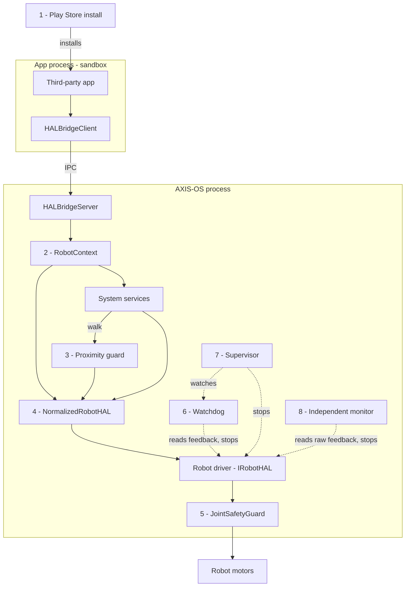

# AXIS-OS

[](https://github.com/OS-AXIS/AXIS-OS/actions/workflows/tests.yml)
[](LICENSE)

*Version française : [README.fr.md](README.fr.md).*

AXIS-OS is an open-source operating system for humanoid robots. Like
Android for phones, it separates what every robot needs (safety, system
services, an app store with permissions) from what is specific to one
robot (a hardware driver), so that the same apps can one day run on robots
from different makers. Today it runs a Unitree G1 **in simulation only**
(NVIDIA Isaac Sim): it has never driven a physical robot.

## The principle: AI proposes, code decides, the OS protects

AI models are good at perceiving and suggesting, and they can be wrong in
ways nobody predicted. AXIS-OS never lets a model's output reach a motor
directly.

1. **AI proposes.** Models produce suggestions: where a box is (OWL-ViT and
   depth), what an operator said (Whisper), how to keep balance while
   walking (GR00T Whole-Body Control), which rule to change
   (a language model).
2. **Code decides.** Plain, reviewed code of the app or service accepts or
   refuses each suggestion against explicit rules. Example: when an operator
   says "blue parcels now go to station C", the sorting supervisor treats the
   language model's answer as untrusted data and only applies it if the
   action, colour and station are in a closed list. It has no access to the
   arms, the legs or the safety layer, so even a hallucinated movement order
   has no way to run.
3. **The OS protects.** Every motor command goes through checks that the
   apps and the models do not control: `JointSafetyGuard` rejects invalid
   values (NaN, infinity) and anything beyond the position, velocity, torque
   or acceleration limits of each joint, and never silently "corrects" a
   command; the proximity guard, when a lidar is wired to it (optional;
   today only in the parcel-sorting demo), slows the robot down, then stops
   it, as soon as the lidar sees an unexplained obstacle nearby, whether or
   not anything recognised it as a person; the watchdog triggers an
   emergency stop when a joint crosses a fatal threshold, and a separate
   supervisor stops the robot if the watchdog itself stops running;
   permissions limit what each app may do.

The last point holds for apps that play by the rules. Isolation against a
deliberately malicious app is not finished: see
[Status and limits](#status-and-limits).

## Architecture



The numbered boxes are the safety checks; neither the apps nor the AI
models control them. Dotted arrows run in parallel with the commands.

| # | Check |
|---|-------|
| 1 | Play Store: the signature (when the app declares one, or always with `require_signed_apps=True`), the permissions, and the user's confirmation for DANGEROUS ones |
| 2 | RobotContext: the permission of each call, a refusal during an emergency stop, the velocity cap |
| 3 | Proximity guard (optional, with a lidar): slows, then stops the walk near an unexplained obstacle |
| 4 | NormalizedRobotHAL: rejects NaN and infinite angles |
| 5 | JointSafetyGuard, for every joint command: position, velocity, torque, acceleration and step size |
| 6 | Watchdog: a joint crossing a fatal threshold triggers an emergency stop |
| 7 | Supervisor: stops the robot if the watchdog itself stops running |
| 8 | Independent monitor: its own limit checks on the raw feedback, then an emergency stop |

The sandbox protects against a buggy app, not yet against a malicious one:
see [Status and limits](#status-and-limits).

A service is something two apps from different trades would both need
(walking, seeing, grasping); anything specific to one trade is an app. The
design is explained in [docs/architecture_services.md](docs/architecture_services.md).

| Folder | Contents |
|--------|----------|
| `axis_os/hal/` | hardware abstraction, safety guard, watchdog, supervisor, drivers (Unitree G1, simulation) |
| `axis_os/services/` | system services shared by all apps |
| `axis_os/store/` | Play Store: manifest and permissions, signing, sandbox, SDK for app developers |
| `axis_os/apps/` | reference apps (parcel sorting, security patrol, inventory…) |
| `axis_os/vla/` | recording demonstrations and evaluating a vision-language-action model |
| `test/` | the test suite, runs anywhere without a GPU |
| `sim/` | validation scripts that run inside Isaac Sim, on a GPU machine |
| `deploy/` | GPU machine setup, systemd service, hardware freshness monitor |
| `docs/` | design notes and validation reports, in French |

## What works

All of the following was measured **in simulation**, in NVIDIA Isaac Sim 6.1
with a Unitree G1. Each result, failures included, is written up in `docs/`
(in French).

| Capability | Evidence |
|------------|----------|
| The same OS and apps on the 23 and 29 degree-of-freedom versions of the G1 | test suite |
| Walking, turning, and a safe stop when an app crashes in the middle of a walk | [validation_locomotion.md](docs/validation_locomotion.md) |
| Open-vocabulary object detection (OWL-ViT); distance to the visible face of a box measured to the centimetre | [validation_perception.md](docs/validation_perception.md) |
| Voice commands; off-topic sentences trigger nothing | [validation_voix.md](docs/validation_voix.md) |
| Several third-party apps on one robot, arbitrated by the OS | [validation_multiapp.md](docs/validation_multiapp.md) |
| Picking up a 1 kg box from a table and carrying it, with zero command refused by the safety guard; then finding the box without being told where it is (each shown in one successful run of a test script, not yet in an app; the box slowly slips, 8 cm in 11 s) | [validation_port_carton.md](docs/validation_port_carton.md) |
| A 30-minute parcel-sorting shift with people walking around, rehearsed on a CPU-only kinematic simulation: the robot never came closer than 0.75 m to a person | [demo_tri_usine.md](docs/demo_tri_usine.md), `test/test_tri_pile_logicielle.py` |

In these demos, AI does the perception and the balance; the arm movements
are still programmed.

## Status and limits

AXIS-OS is research software. Please read this before using it.

- **Simulation only. Not ready for a real robot.** The Unitree G1 driver
  speaks the robot's real protocol (DDS), but it has never been connected
  to a physical robot. Behaviour that is safe in simulation is not
  automatically safe on hardware.
- **App isolation is not finished.** The sandbox protects the robot from a
  buggy app, not from a malicious one: a hostile app can today act outside
  the HAL. **Only install trusted apps whose code you have reviewed.** The
  plan to fix this is in [docs/isolation_apps.md](docs/isolation_apps.md);
  the details are in [SECURITY.md](SECURITY.md).
- **Grasping driven by a vision-language-action model is work in progress.**
  A GR00T N1.7 model fine-tuned on simulated demonstrations is being
  evaluated against the programmed reflexes; it is not reliable yet.
- **No localisation from sensors yet**: in simulation, the robot's position
  is read from the simulator. No mapping (SLAM), no hands with fingers, no
  fleet management (only a design note).
- The 30-minute sorting demo has been rehearsed on CPU; its full run in
  Isaac Sim is still to be done.

## Run the tests (no GPU needed)

The test suite checks the safety layer, the Play Store, the services and
the reference apps without a GPU, a simulator or any AI model. It takes
about 7 minutes on a 4-core machine.

```sh
git clone https://github.com/OS-AXIS/AXIS-OS.git
cd AXIS-OS
python3 -m venv .venv
. .venv/bin/activate
pip install --require-hashes -r requirements-ci.txt
pytest test/
```

Python 3.12 or newer (the CI tests 3.12; also tried locally with 3.13).
Each file in `test/` is also a standalone script:
`python3 test/test_safety_v2.py` runs one of them and prints each check.
The same suite runs on every push (`.github/workflows/tests.yml`).

Running the simulation scripts needs an NVIDIA GPU and the Isaac Sim
container: see [sim/README.md](sim/README.md) and `deploy/machine_gpu/`.

## Learn more

- [Write an app for AXIS-OS, from scratch](docs/CREATE_AN_APP.md), no robot or GPU needed
  ([version française](docs/CREER_UNE_APP.md))
- [What a robot needs to run AXIS-OS](docs/PREREQUIS_ROBOT.md)
- [Integration of GR00T Whole-Body Control](docs/integration_gr00t_wbc.md)
- [App isolation: findings and plan](docs/isolation_apps.md)
- [Glossary of the French terms used in the code](docs/GLOSSARY.md)

## License

Apache License 2.0 (see [LICENSE](LICENSE)). Third-party files included in
the repository are listed in [NOTICE](NOTICE). No model weights are
included; the models AXIS-OS can use, and their licenses, some of which are
not open source, are listed in [THIRD_PARTY.md](THIRD_PARTY.md).

## Contributing and security

Contributions are welcome: see [CONTRIBUTING.md](CONTRIBUTING.md) and the
[code of conduct](CODE_OF_CONDUCT.md). To report a vulnerability, please do
not open a public issue: follow [SECURITY.md](SECURITY.md).

## Contact

axis.project.dev@gmail.com
