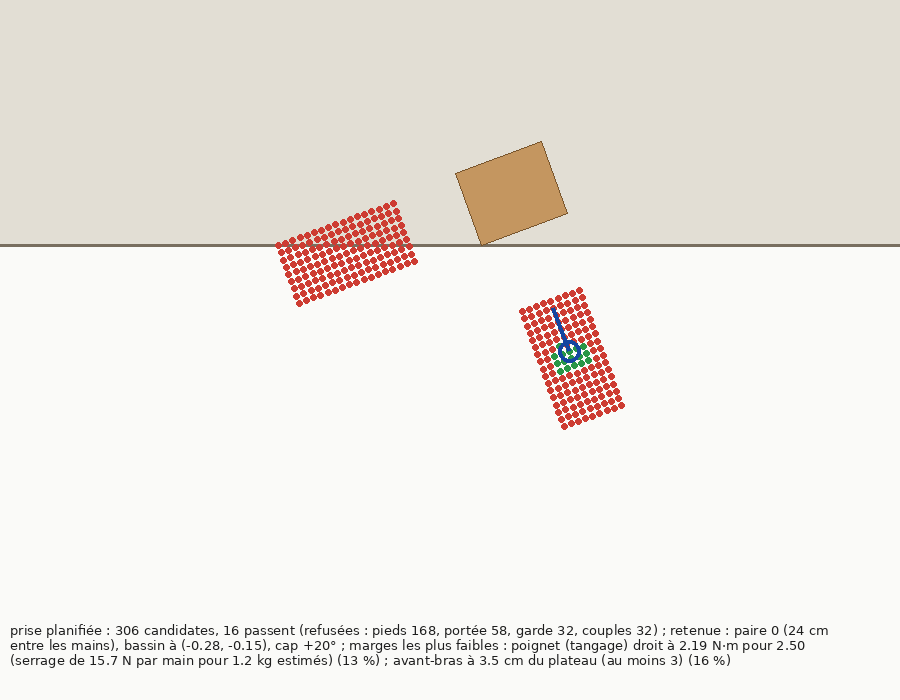
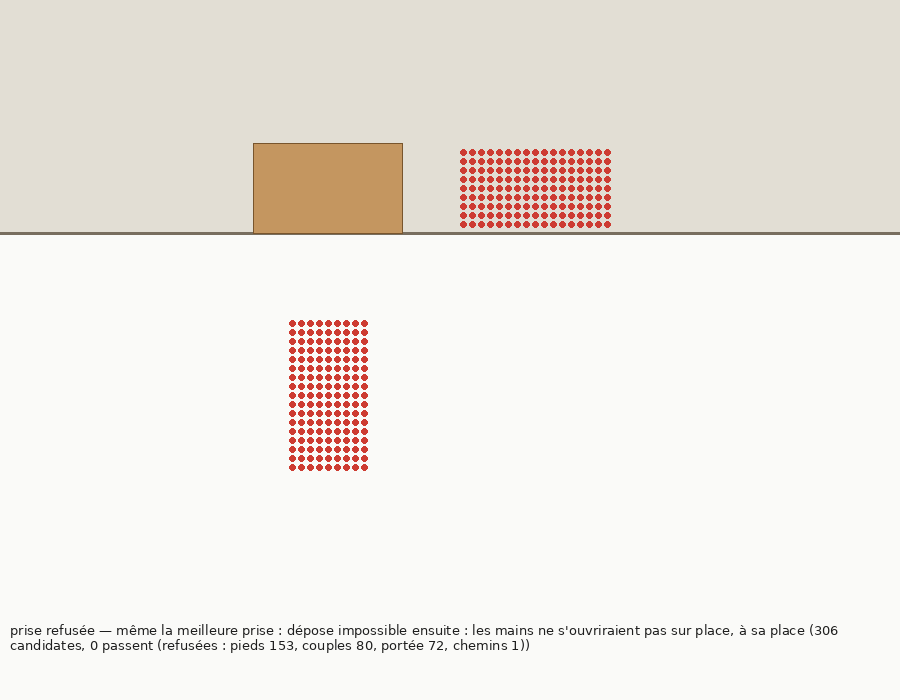

# Validation — prendre un carton, le porter, l'emporter (2026-09-25)

G1 29 DOF, politique GR00T Whole-Body Control, Isaac Sim 6.1, sur une
instance L4. Reproductible via `sim/validation/test_isaac_w3_gr00t_table.py`.

---

## 1. Résultat

**Le robot prend un carton d'un kilo posé sur une table, le soulève,
recule, fait demi-tour et l'emporte — sans le lâcher, sans tomber, sans
une seule consigne refusée par le garde-fou.**

| Phase | Hauteur du carton | |
|---|---|---|
| Posé sur la table | 0.900 m | |
| Soulevé | **0.95 m** (max) | +5 cm |
| Recul, 68 cm | 0.93 m min | tenu |
| Demi-tour sur place | 0.89 m min | tenu |
| Marche avant, 1.07 m | 0.87 m min | tenu |
| Arrêt | 0.84 m min | tenu |

Distance du carton au bassin : **0.38 m, constante** du soulèvement à
l'arrêt. 901 pas de locomotion, 0 chute, 0 refus.

**Réserve :** le carton glisse lentement — 8 cm en 11 s. La prise est
bonne, pas définitive : sur un long trajet, il finirait par tomber.

---

## 2. Onze essais, sept problèmes, chacun silencieux

| Essai | Symptôme | Cause | Correctif |
|---|---|---|---|
| W1 | tout passe | **mais** la posture « de port » envoyait les bras en arrière | voir §3 |
| W2-1 | plantage | taille du carton changée en cours de simulation | taille fixée à la création |
| W2-2 | mains derrière le bassin | étiquettes anatomiques inversées | posture par cinématique |
| W2-3 | carton tombe d'emblée | placé entre des mains encore ouvertes | scène sur table |
| W3-1 | robot recule de 26 cm | la table poussait sa cuisse | table avancée |
| W3-2 | **mains traversent le carton** | **URDF officiel : mains sans collision** | copie dérivée |
| W3-3 | carton bascule, glisse | poignets trop souples (raideur 4) | poignets raidis |
| W3-4 | carton tombe par le bord | 3 cm d'appui sur la table | plateau fin + pied |
| W3-5 | lâché en marche avant | frottement par défaut | matériau caoutchouc |
| W3-6 | plantage | matériau posé après l'initialisation | posé avant |
| **W3-7** | **tout tient** | | |

---

## 3. Trois découvertes qui dépassent ce test

**Les étiquettes anatomiques de la table de conventions sont fausses**
pour le tangage d'épaule et le coude. Un tangage positif recule le bras ;
un coude positif le déplie. Toute app qui demande une « flexion » obtient
le mouvement opposé. Voir `integration_gr00t_wbc.md` §8. À corriger par un
contrôle systématique en cinématique directe.

**L'URDF officiel du G1 29 DOF n'a aucune collision aux mains.** Les liens
`left_rubber_hand` et `right_rubber_hand` ne sont que des visuels. Tout
utilisateur de ce fichier pour de la manipulation a le même problème. À
signaler à Unitree. Contourné par une copie dérivée, testée pour rester
fidèle à l'original.

**Règle d'Isaac Sim** : tout ce qui touche la physique — ajout ou
suppression d'objet, taille, matériau — se pose **avant**
`world.reset()`. Après, la vue physique est invalidée. Trois plantages
de la même famille (A3, W2, W3).

---

## 4. Ce qui reste pour le Graal complet

- **Serrage plus ferme ou prise contre le torse**, pour supprimer le
  glissement lent.
- **Approche** : le robot part déjà placé devant la table. Il faudra qu'il
  la trouve, s'en approche et se positionne au centimètre.
- **Dépose** sur une autre table.
- **L'app** qui orchestre le tout, pilotée à la voix.
- **Arbitrage des actionneurs** : ici, c'est le script qui commande les
  bras via l'adaptateur de marche. Dans l'OS, l'app devra posséder les
  bras pendant que la marche possède les jambes.

---

## 5. W4 — « Va prendre le carton », sans lui dire où il est

`sim/validation/test_isaac_w4_gr00t_autonome.py`. Le robot ne reçoit **aucune position**.
Le carton est posé sur une table à 90° sur sa gauche, hors de son champ de
vision au départ.

| t | État | |
|---|---|---|
| 0.0 s | CHERCHER | il tourne sur lui-même |
| 3.3 s | APPROCHER | OWL-ViT reconnaît le carton — face avant mesurée à 4 cm près |
| 12.9 s | SAISIR | le carton est entre ses mains : il serre |
| 13.8 s | SOULEVER | |
| 15.0 s | RECULER | prise **vérifiée** avant de partir |
| 17.5 s | TOURNER | demi-tour, carton en main |
| 21.8 s | EMPORTER | |
| 25.0 s | DÉPOSER | au sol, à 2.30 m de la table |
| 27.5 s | FINI | |

0 chute, 0 refus du garde-fou.

**Ce qui relève de l'IA :** la recherche et la localisation (OWL-ViT +
profondeur), l'équilibre et la marche sous charge (GR00T WBC). **Ce qui
reste programmé :** le mouvement des bras — l'app sait *comment* prendre,
la perception lui dit *quand* et *où*. La décision de serrer vient de la
perception, pas d'une seconde fixée d'avance.

### Quatre essais, trois leçons

**La caméra doit regarder là où est l'objet.** Premier essai : rien reconnu
en une minute. La vue enregistrée par la tête du robot a montré le carton
coupé par le haut du cadre : visée reprise des tests où les cartons étaient
au sol, et angle mal calculé (36° vers le bas au lieu de 20°). **Enregistrer
ce que voit le robot** a tranché en un coup d'œil, là où on aurait accusé le
détecteur.

**Sous 0.05 m/s, GR00T WBC ne marche plus : il tient debout.** Des consignes
d'ajustement fin de 2 à 3 cm/s ne font rien bouger. Les petits pas doivent
être francs.

**La règle d'un humain vaut mieux que la précision d'une machine** (règle
de Kenzo). Exiger une immobilité parfaite près d'une table échouait : la
politique de marche ne s'immobilise jamais tout à fait. « Dès que le carton
est entre les mains, on serre » a réussi du premier coup — vérifié avec ce
que le robot sait vraiment : ses mains par ses articulations, le carton par
sa caméra.

### Limites

- **Fin d'approche à l'aveugle** : sous ~0.9 m, l'estimation est figée et
  recalée par la pose du robot, exacte en simulation. Sur le vrai robot, il
  faudra une odométrie.
- **Prise vérifiée** par la position simulée du carton. Sur le vrai robot :
  l'effort mesuré aux épaules.
- **Dépose au sol** par ouverture des bras, pas encore sur une table.
- Tout le déroulé vit dans un script de test, pas encore dans une **app** du
  Play Store : il faut d'abord l'arbitrage des actionneurs entre services et
  la correction des étiquettes anatomiques.

---

## 6. Essai T1 du 5 novembre 2026, 21 h 57 : prise parfaite, glissement au port

Prise parfaite (point de contact au milieu de la face, force estimée 6,46 N
contre 6,5 au juge, ligne des mains à 0,0 cm du centre de gravité), levée ;
puis le carton glisse au port. L'OS le voit (« le carton ne pèse plus sur
les mains (3.5 N, 11.3 au levage) ») et s'arrête proprement, aucun carton au
sol. Rejoué dans `test/test_rejeu_port_t2157.py`
(`test/donnees/t1_prise_20261105_2157.csv`).

### Ce que disent les données

| Constat | Valeur |
|---|---|
| Poids mesuré par l'OS | 10,6 N en haut du levage, 11,1 au plus (vrai : 9,8) |
| Serrage réel (juge) | 6,3 N par main |
| Marge de frottement μ (N_G + N_D) / poids, μ = 0,8 | 0,8 à 0,9 au port |
| Écart des faces mesurées au port | constant à 2 mm près ; chaque face bouge de 5 cm |
| Consigne de la main droite | desserrée de 5 mm au port, jamais resserrée |
| « Contre le torse » | à 3 N, face arrière du carton à 33 cm du bassin, torse attendu à 10 |

- **Les mains ne s'écartent pas** : la marche balance l'ensemble mains et
  carton (± 2,5 cm) ; une face prise seule semble s'écarter, l'écart des
  deux ne bouge pas.
- **La consigne qui change** : le tangage du poignet droit porte 2,0 à
  2,7 N·m, surtout du poids ; à chaque pointe au-delà de son plafond
  (2,5 N·m), `_garder_sous_la_limite` desserre d'un pas : 5 mm, soit ~1 N de
  serrage perdu, pour 0,04 N·m de moins au poignet.
- **La traction** : torse hors d'atteinte, la poussée de 3 N vers le robot
  n'était pas le torse.

### Ce qui change

- **Serrage d'après le poids** (`ReglagesPrise.securite_serrage` = 2,
  `frottement_serrage` = 0,8, `marge_serrage_n` = 1) : en haut du levage, la
  prise confirmée, l'OS serre jusqu'au serrage requis
  `securite × poids / (2 μ)` (le plus grand poids mesuré depuis le levage),
  visé avec 1 N de marge, avant de ramener. Consigne au plus
  `penetration_poids_max_m` = 6 cm dans la face touchée (raideur au contact
  ~300 N/m sur GPU : 15 N demandent ~5 cm). Plafonds de couple inchangés :
  on ne serre plus si une articulation des deux bras est à moins de 0,3 N·m
  du sien. Bloqué sous le requis pendant 3 s : le carton est reposé
  doucement, « trop lourd pour ces mains ». Faces mesurées qui se
  rapprochent de plus de 1 cm : « le carton cède sous le serrage », reposé.
  Au journal : `serrage d'après le poids : G … N, D … N par main pour … N
  de poids (requis …, visé …)`.
- **Ramener** : si le carton ramené ne peut pas toucher le torse, il est
  rapproché en position, sans arrêt sur un effort vers le robot (au journal :
  « (torse hors d'atteinte) »). Torse atteignable : l'arrêt au toucher reste.
- **Port** : la consigne desserrée par un plafond est rendue dès que les
  bras le permettent ; mains écartées de plus de 5 mm de leur serrage (somme
  des deux mains), ou marge de frottement sous 2 : la base s'arrête, on
  resserre ; sans retour en 1 s, à reposer (« serrage perdu au port »).

### Ce que le rejeu prévoit pour le prochain essai

Le serrage, au point de contact 11 cm le long de la main, charge les
poignets (lacet surtout, ~0,15 N·m par newton). Pour ce carton (11,1 N
mesurés), il faut 13,9 N par main : les poignets y seraient à 2,1 N·m en
médiane, 2,6 en pointe, pour un plafond de 2,5. L'OS s'arrêterait vers 13 N
par main (marge 1,9) et **reposerait le carton, « trop lourd pour ces
mains »**, de peu. Les leviers sont des réglages, pas du code :
`frottement_serrage` (le banc : caoutchouc 1,0, carton 0,8 en frottement
dynamique), `securite_serrage`, le poids mesuré par l'OS (13 % au-dessus du
vrai sur cet essai), ou la part du plafond des poignets.

---

## 7. Essai T1 du 6 novembre 2026, 18 h 21 : poids gardé trop haut, carton tordu au retour

Couples fiables, perception, contact et ligne des mains bons (juge : 2 vrais
contacts, 0 manqué, 0 faux). « serrage d'après le poids : G 14.6 N, D 14.4 N
par main pour 11.4 N de poids (requis 14.3, visé 15.3) » ; au port, marge de
frottement 1,58 puis 1,93 malgré le resserrage : à reposer. Le carton n'est
pas tombé. Rejoué dans `test/test_rejeu_port_t1821.py`
(`test/donnees/t1_prise_20261106_1821.csv`).

### Le poids : 11,4 N pour 9,8

- **L'estimation est juste bras immobiles :** les 15 lectures qui suivent la
  confirmation de la prise, en haut du levage, ont une médiane de 9,85 N
  (essai de 21 h 57 : 10,0 N en fin de levage).
- **La référence ne l'était pas :** c'était le plus grand poids lu depuis le
  levage. Elle a gardé 11,44 N, la toute première lecture après la remise à
  zéro de la moyenne glissante à la confirmation, une seule lecture, bruitée.
  Au retour, bras en mouvement et carton tordu, l'estimation a monté
  jusqu'à 11,8 N.
- **Ce qui n'est pas en cause :**
  - le modèle de pesanteur et le poids des avant-bras : résidu de la
    calibration 0,10 N·m au plus, pente 1,00 ; rejoué sur les couples de
    l'essai, le modèle des bras de l'URDF donne 9 à 10 N, torse supposé droit ;
  - le point de contact : le vrai est à 12,4 cm le long de la main (11 dans
    le modèle), 2,5 cm au-dessus de son axe, à la surface de la paume ; le
    prendre change l'estimation de 5 % au plus, et la fait passer sous le
    vrai poids : il reste à 11 cm, réglé sur la force normale (essai de
    16 h 06) ;
  - le frottement vertical, porté à la surface de la paume : sans effet,
    bras immobiles.

**Ce qui change :** le poids est pesé une fois, bras immobiles, en haut du
levage, avant de serrer plus : la médiane d'une fenêtre de
`filtre_force × 3` lectures (`ManipulationService.poids_carton`, au
journal). C'est sur lui que se calculent le serrage requis et la marge de
frottement au port. Le plus grand poids lu ne sert plus qu'au contrôle de
glissement du port (inchangé). Le serrage ne monte plus en levant : il monte
en haut, une fois le carton pesé.

### Le retour : les deux mains ne bougeaient pas comme un seul corps

La cinématique inverse du retour ne tenait que la **position** des points de
contact (tangage et roulis d'épaule, coude). Reconstruites sur les angles
mesurés :
- les paumes ont piqué de ~15° autour de la ligne des mains ;
- la gauche a roulé de ~10° de plus que la droite (l'épaule gauche a roulé de
  −10,5°, la droite de +0,5°) ;
- le carton s'est tordu entre elles : 9,7° de rotation, 4,6 cm de glissement
  à la main gauche, 6 N de serrage perdus du début du retour au port.

**Ce qui change :**
- **Corps rigide :** au retour, chaque main garde son orientation et suit la
  même translation, à `tol_rigide_deg` (1°) et `tol_rigide_m` (1 mm) près,
  par une cinématique inverse de la pose entière sur les articulations que
  la prise commande. Le mode reste en place, objet tenu, pour les gestes
  qui suivent (dépose). Là où il n'arrive pas, le geste est refusé (hors
  d'atteinte), comme avant : l'ancienne cinématique, partie des angles du
  serrage, ferait tourner les mains d'un coup (60° constatés sur le robot
  simulé, dans une descente vers un plateau trop bas).
- **Chemin vérifié d'avance :** étapes de 1 cm, aucune articulation qui
  saute de plus de 0,15 rad d'une étape à l'autre, avant-bras jamais plus
  près du plateau que 3 cm (ni qu'au départ, en haut du levage).
- **Sinon :** on rapproche moins, ou seulement plus haut, ou pas du tout :
  le carton est porté là où le levage l'a laissé (au journal).
- **Dépose et montée au-dessus d'un plateau, objet tenu :** tout le chemin
  est vérifié avant de bouger. La dépose le vérifie par étapes de 2 mm, le
  pas qu'elle commande à chaque tour ; la montée par étapes de 1 cm. Plateau
  hors d'atteinte : l'objet reste tenu là où il est, sans bouger (« dépose
  impossible » ; FAILED/OUT_OF_REACH pour une app).
  - Avant : une descente arrêtée en chemin ne remontait pas forcément. Sur
    le robot simulé, coude en butée, la pose rigide ne se tenait plus là où
    le retour passait.
  - L'interpolation des angles prenait alors le relais : mains tournées de
    30°, carton tombé de 7 cm, retour arrêté par la surveillance (test SDK,
    5 fois sur 6).
  - En corps rigide, les angles ne sont plus jamais interpolés : un geste
    dont la pose ne se tient plus s'arrête au dernier point tenu, et l'OS
    sait où sont les mains.
- **Prix :** les plateaux bas sortent d'atteinte en corps rigide. Sur le
  robot simulé, la limite est vers 70 cm pour un carton tenu à 30 cm du
  bassin, et 75 cm à 41 cm. Les plateaux de la scène T1 sont à 80 cm.
- **Six articulations au moins :** la pose entière d'une main demande six
  articulations commandées, tangage du poignet compris. Un bras à cinq
  (HAL 23 DOF) ne ramène pas le carton.
- **Rejoué :** sur la posture réelle de la fin du levage de l'essai, le
  chemin rigide passe (10,5 cm vers le buste, 5 cm plus haut), mains à
  0,00° de leur orientation de départ. C'est le tangage du poignet qui
  compense : de +0,03 à +0,5 rad.
- **Surveillance :** pendant le retour en corps rigide, le roulis (autour de l'axe avant) et
  le tangage (autour de la ligne des mains) du carton sont estimés sur les
  mains mesurées : rotation moyenne des paumes, et pente de la ligne des
  mains. Au-delà de `rotation_ramener_max_deg` (4°), le geste s'arrête et
  l'on resserre avant de marcher : la base reste arrêtée jusqu'au serrage
  visé, et d'au moins `marge_serrage_n` de plus à chaque main. Les couples
  ne servent pas ici : le couple de basculement passe sous leur bruit.
  Rejouée sur l'essai, cette surveillance aurait arrêté le retour à
  43,66 s, carton tourné de moins de 3°.

### Le port rejoué

Sur le poids pesé (9,85 N), avec le serrage visé gardé par le retour rigide
(13,3 N par main, que les mains ont dépassé pendant l'essai), les baisses de
force du port reprises : marge de frottement 2,13 à 2,16. Essai de 21 h 57,
sur son poids pesé (10,0 N) : les poignets laissent monter le serrage au
requis (12,5 N par main), et la marge reste entre 2,08 et 2,20 pendant tout
le port rejoué.

### À vérifier au prochain essai GPU

- Les lignes du journal :
  - `poids du carton : … N (médiane de 15 lectures …)`, près de 9,8 ;
  - `serrage d'après le poids : …`.
- Au retour, l'une de ces lignes :
  - `carton ramené sans toucher le torse : …`, sans `retour arrêté` ;
  - ou `retour : … porté là où le levage l'a laissé`.
- Sur la vérité du banc, le roulis et le tangage du carton au retour, sous 2°.

## 8. Campagne de cartons variés : la prise hors du seul carton T1

La prise a été mise au point sur un seul carton : celui de la scène T1, 24 ×
20 × 20 cm, ~1 kg, posé toujours sur la même table, à la même place. La
campagne essaie l'OS sur des cartons tirés au hasard, graine fixée, donc
rejouables (`axis_os/testing/cartons.py`, `test/test_campagne_cartons.py`).

### Ce qui est tiré, et comment c'est essayé

- **Cartons** : largeur 15 à 35 cm, profondeur 15 à 30, hauteur 10 à 30,
  masse 0,2 à 2,5 kg, frottement des mains sur leurs faces 0,5 à 1,2, lacet
  de −45 à 45°, retrait de 0 à 25 cm depuis le bord de la table (dans et
  hors de portée), décalage le long du bord.
- **Hors des moyens, exprès** : un carton sur dix trop large (45 à 60 cm),
  un sur dix trop lourd (3 à 5 kg).
- **Rejouable ailleurs** : le tirage ne dépend que de
  `random.Random(graine).random()` ; le banc Isaac tire les mêmes cartons
  (`lancer_t1.sh --cartons-varies N`, graine au journal).
- **Comme sur le banc T1** : approche face à la table à la distance de
  prise de l'OS (erreur de navigation de ±2 cm et ±3° comprise), bras ouverts
  pour ce carton, insertion, prise, port, dépose sur la table. Les couples
  estimés portent le bruit, le biais et le gain du banc (`BruitCouples`).
- **Ce qui ne doit jamais arriver** (vérité du robot simulé), sinon le test
  échoue :
  - carton tombé, ou lâché à plus de 3 cm de haut ;
  - écrasé : consigne de serrage au-delà de ses bornes, ou contact vu trop
    tard (main à plus de `tol_face_contact_m` dans la face) ;
  - couple vrai au-delà du plafond de l'OS (à l'erreur d'estimation du banc
    près) ou de la limite matérielle ;
  - prise confirmée les mains vides ;
  - carton perdu sans que l'OS le voie.
- **Chaque refus a une raison claire**, d'une catégorie connue.

### Ce qu'elle a trouvé, et ce qui est corrigé

- **Bras ouverts qui heurtent le carton à l'insertion** : la pré-saisie fixe
  (`roulis_presaisie`, réglée sur le carton T1) ne laisse que 27 cm entre
  les paumes. Tout carton plus large vu de face était heurté, plafonds de
  couple dépassés de 1 à 2 N·m.
  - `presaisir(objet)` ouvre juste assez : largeur vue de face plus
    `jeu_ouverture_m` de chaque côté, au plus `roulis_presaisie_max` (45 cm
    libres), les mains gardées à la même hauteur.
  - Un carton trop large même ouvert en grand est refusé d'avance
    (`distance_de_prise` : « trop large pour les mains »).
  - L'app de tri ne s'en sert que si on le lui demande
    (`ConfigFacade.presaisie_ajustee`, activé par la campagne GPU) : le tri
    T1 ne change pas.
- **Fond du carton porté** : les repères des mains le donnaient de 2 cm trop
  haut (carton de 13 cm enfoncé dans la table à la dépose) à 3 cm trop bas
  (carton de 30 cm « déjà sous le plateau », pas reposé sur sa table). Il est
  maintenant estimé aux points de contact, moins leur hauteur au-dessus du
  centre du carton à la prise ; les cibles de la descente et de la montée en
  tiennent compte. La dépose est exacte à quelques millimètres.
- **Carton resté sur la table** : un carton de 1,8 kg à peine tenu par le
  serrage de prise y restait, les mains glissant de 3,8 cm le long de ses
  faces ; l'OS confirmait la prise, pesait 0,2 N et partait avec. Pesé sous
  `poids_min_n` (1 N), il est reposé : « ne pèse pas sur les mains ».
- **Levage sans fin** : avec les couples bruités du banc, le délai qui juge
  « trop lourd » repartait à chaque avance aussitôt défaite par le
  garde-plafond. Il ne repart plus que sur un vrai progrès.
- **Charge plafonnée** (`masse_max_kg`, 1,2 kg) : un carton pesé au-delà est
  reposé dès la pesée, en haut du levage d'essai (4 cm), avant d'être serré
  plus ou porté : « trop lourd : X kg pesés, au plus 1.2 kg ». La masse ne
  se connaît qu'en pesant, donc qu'une fois le carton soulevé de ces 4 cm.
  - **Pesée tarée** : le plafond est jugé sur la hausse des couples depuis
    le zéro d'avant la fermeture, où leur biais s'annule, calibré ou non.
  - **Pourquoi** : sans calibration des couples, leur biais (0,5 N·m au
    plus par articulation) faisait peser un carton de 1 kg de 0,77 à
    1,23 kg ; taré, de 0,92 à 1,05 kg (16 tirages du bruit du banc). Pesé à
    1,23 kg, le carton T1 lui-même était refusé (`test_force_main` §6).
- **Dépose : mains ouvertes sur place, jamais en remontant** (voir plus bas,
  « Dépose à la limite de portée »).
- **Robot simulé**, pour que ces cas existent :
  - masse et frottement propres à chaque carton ;
  - glissement quand le frottement ne porte plus le poids ;
  - carton porté à l'équilibre des forces des deux mains (au milieu des mains
    mesurées, un carton tourné de 10° tombait au retour) ;
  - faces bornées à leur rectangle, tables en option ;
  - carton accroché là où les mains l'ont serré.

### Ce que montre le rapport (graine 20261118)

- **Tirés dans toutes leurs plages à la fois, presque aucun carton n'est
  pris** : 0 déposé sur 120, 2 reposés, 118 refusés. Hors de portée : 90 ;
  trop large : 23 ; trop lourd ou trop glissant pour le serrage de prise :
  5. Aucun cas interdit.
- **Un paramètre à la fois autour du carton T1** (balayage du test), la
  prise réussit :
  - largeur de 15 à 30 cm ;
  - profondeur de 15 à 30 cm ;
  - hauteur de 13 à 25 cm ;
  - masse jusqu'à ~1 kg ;
  - frottement dès 0,6 ;
  - lacet jusqu'à 12° (la scène T1 tire ±12°) ;
  - retrait du bord de 5 cm au plus.
- **Ses limites, raisons comprises** :
  - carton de 10 cm de haut : avant-bras trop près du plateau ;
  - dès 1,2 kg : trop lourd pour les poignets du G1 (plafonds de 5 N·m) ;
  - μ = 0,5 : il ne suit pas le levage ;
  - lacet de 13 à 20° : pris et porté, mais posé sur la table, les mains ne
    s'ouvrent plus sur place autour de lui (5 cm de jeu de chaque côté, bras
    tendus) : dépose refusée, carton reposé à sa place ;
  - lacet de 30° et plus : hors de portée, le robot abordant la table de face ;
  - à 20 cm du bord de la table : hors de portée à toute distance.

### Les réglages choisis sur le carton T1

| Réglage | Sur la campagne | Verdict |
|---|---|---|
| `frottement_serrage` 0,8 | Cartons à μ 0,5 et 0,6 portés avec une marge vraie de 1,38 à 1,46, l'OS en croyant 1,74 à 2,30 ; garantie au serrage requis : 2 × μ / 0,8, soit 1,25 à μ 0,5 | **Réglé pour T1** (μ ≥ 0,8). À 0,5, la marge vraie ne descend plus sous 2,04, mais les mains ne portent plus que ~0,6 kg : le carton T1 lui-même devient trop lourd. **Proposition** : mesurer le frottement caoutchouc/carton du site ; le garder à 0,8 pour les cartons T1 (μ = 1 au banc), le descendre à la mesure pour tout autre carton. Inchangé ici. |
| `rotation_ramener_max_deg` 4° | Rotation estimée au retour : 1,1° au plus sur la campagne, 3,3° sur une grille d'essai jusqu'à 1,2 kg. Un carton de 1,39 kg, aux plafonds de couple, l'a dépassée (4,7° estimés) sans tourner : retour arrêté à tort, mais au-delà de ce que les mains portent | **Tient**. Inchangé. |
| `penetration_poids_max_m` 6 cm | Jamais atteinte : avance de 3,4 cm au plus sur la campagne, 5,2 sur un balayage d'essai aux couples bruités ; ce sont les plafonds de couple qui limitent d'abord | **Tient**. Inchangé. |
| Seuils de contact (`force_contact_n`, `sigmas_contact`, `hausse_contact_nm`) | Contact vu la main 0,8 à 1,2 cm dans la face (au plus 1,5) quels que soient taille, masse et lacet, bruit du banc compris ; aucun refus de contact | **Tiennent**. Inchangés. |
| `roulis_presaisie` 0,32 | 27 cm entre les paumes : tout carton plus large était heurté | **Réglé pour T1** : corrigé, pré-saisie à la largeur du carton (voir plus haut). |
| `masse_max_kg` 1,0 | C'est la masse du carton T1 ; les mains portent jusqu'à ~1,2 kg | **Réglé pour T1** : passé à 1,2 kg, la charge que les mains portent (tolérance de la ligne des mains au centre de gravité : 1,45 cm au lieu de 1,7). Au-delà, reposé dès la pesée. |
| `force_serrage_n` 8 N | 8 ou 12 N ne changent rien : le serrage de prise est borné par `penetration_max_m` (2 cm, ~9 N avec les bras du G1) | **Proposition** : au second essai d'un carton qui n'a pas suivi, serrer jusqu'à la borne d'après le poids. Inchangé ici. |

### Ce qui reste

- **Aborder le carton dans l'axe de ses faces** (cap de prise tourné de son
  lacet) : c'est ce qui ferait passer les lacets de 30° et plus.
- **L'app de tri suppose un seul carton** : réglage de taille unique, et
  perception qui ajuste une boîte de cette taille. La campagne GPU lui donne
  la vraie taille de chaque carton posé ; il faudrait qu'elle la perçoive.
- **Plateaux bas** : à atteindre en pliant le corps (taille, genoux), pas en
  inclinant les mains.
- **La repose à sa place** (`poser()` sans plateau, après une dépose
  refusée) peut encore rouvrir les roulis si les mains ne s'ouvrent pas sur
  place (carton tourné de 13° et plus) : il est alors sur sa table, et les
  mains remontent de 0,4 cm en s'ouvrant.
- **Ouvrir sur place autour d'un carton tourné** : 5 cm de jeu de chaque côté
  ne passent plus dès ~13°, bras tendus. Un jeu plus petit passe (1 cm à 20°)
  et suffirait à le lâcher, si le retrait des mains qui suit est vérifié.
- **La campagne ne calibre pas les biais des couples**, le banc si : la
  pesée qui règle le serrage garde ce biais. Un carton T1 de 16 cm, pesé
  1,25 kg, y est refusé « trop lourd pour ces mains ».
- **Campagne GPU, après le premier tri réussi** :
  `bash lancer_t1.sh 3600 10 --cartons-varies 40`. Bilan par plage et
  raisons en fin d'essai, détail dans `videos/t1_campagne_cartons.json`.

### Dépose à la limite de portée : jamais lâchée en remontant

Avant, un carton de 20 cm (mains idéales) était posé jusqu'à un plateau de
71 cm, mais à 71 cm les mains ne pouvaient pas s'ouvrir sur place.
- **Le repli d'`_ouvrir`** : il rouvre les roulis de 0,3 rad, et les mains
  remontent de 2,4 cm en s'ouvrant. Le carton était lâché 3,4 cm au-dessus
  du plateau.
- **Antérieur à la campagne** : elle ne pose que sur la table de prise, et ne
  l'a pas vu.

Désormais (`test_depose_limite_portee.py`) :
- **Avant de descendre**, le chemin est vérifié, et aussi l'ouverture sur
  place des mains en bas.
  - **À quelques mm près** : `_ouvrir` part des mains mesurées, qui cèdent
    sous la charge de 3 à 5 mm, et l'ouverture d'un carton tourné en
    dépend : à 12°, elle passe 4 mm plus près du robot, pas à la consigne.
  - **Refus seulement si aucune de ces places ne la permet**, sinon le tri T1
    (±12°) perdrait des déposes.
  - **Après un refus**, l'objet reste tenu, rien ne bouge (place() :
    FAILED/OUT_OF_REACH).
- **En bas, là où sont les mains**, l'ouverture est vérifiée de nouveau.
  Impossible, l'objet n'est pas lâché : il est remonté, tenu (« vu en
  bas »).
- **Plateau par plateau**, pour ce carton :
  - jusqu'à 70,75 cm, refusé, chemin hors d'atteinte ;
  - de 71 à 71,25 cm, refusé avant de descendre ;
  - de 71,5 à 71,75 cm, descendu puis remonté, tenu ;
  - dès 72 cm, posé à 3 mm du plateau.

## 9. Portée : se rapprocher, se pencher, et ce qui reste

La campagne (§8) refusait 90 cartons sur 120 « hors de portée ». Cette étape
cherche ce qui les en empêche, et ce qu'on peut gagner sans rien affaiblir.

### Pourquoi « hors de portée » (rapport de campagne)

Chaque refus dit maintenant sa cause.
- **Longueur des bras** : sans la règle du bord de la table, jusqu'à quelle
  distance les mains atteignent-elles le milieu des faces ? De la plus
  longue au robot au plus près permis, l'écart est ce qui manque.
- **Lacet** : la distance de prise se calcule de face ; une face du carton
  tourné est plus loin qu'une main n'atteint.

Sur la graine 20261118, avec le robot à 21 cm du bord au plus près :
- 28 refus par la longueur des bras, il manque de 2 à 11 cm (médiane 5),
  et 6 cartons hors d'atteinte à toute distance (des cartons bas, que la
  garde des avant-bras refuse) ;
- 36 refus par le lacet (cartons tournés de 5 à 44°).

**Correction** : le premier rapport disait « il manque de 5 à 18 cm,
médiane 13 ». C'était faux : l'écart partait de la distance de prise la plus
COURTE qui convenait, pas de la plus longue. Il surestimait le manque de
7 cm en médiane.

### Se rapprocher : pieds contre la table, tant que la garde des avant-bras tient

- **`bord_min_m` : 15 → 10 cm.** La pointe des pieds du G1 debout est à
  9,9 cm devant le bassin (URDF), et `test_equilibre.py` vérifie que le bord
  n'est jamais plus près.
- **Découvert en chemin** : la règle du bord portait sur les repères des
  mains, 11 cm en deçà du point de contact des mains du G1
  (`distance_ideale`). Le bassin restait donc à 21 cm du vrai bord au plus
  près (26 avant), et les pieds à 11 cm de la table.
- **Seconde décision de revue : « ce qui reste des 11 cm, tant que la garde
  des avant-bras au-dessus du plateau est tenue (3 cm) ».** `distance_ideale`
  procède en deux paliers :
  1. **D'abord la distance de toujours**, règle d'avant inchangée : les
     cartons déjà pris le sont à la même distance (vérifié sur 288 cas : les
     130 distances d'avant sont identiques, 60 cas de plus sont atteints).
  2. **Seulement si les bras n'y arrivent pas** : jusqu'à `bord_min_m` du
     vrai bord (pieds contre la table). La garde des avant-bras se juge au
     vrai bord, dans la posture de l'approche ET dans celle de la prise (les
     points de contact au milieu des faces, la main comprise) : l'approche ne
     choisit jamais une distance que la prise refuserait
     (`test_rapprochement.py`).
- **Pourquoi deux paliers** : jugée partout au vrai bord, la règle
  rapprochait aussi les cartons déjà pris. Un carton T1 tourné de 10°, pris
  jusque-là à 43 cm, l'était à 36 cm, et sa dépose ne trouvait plus de
  chemin (balayage autour du carton T1).
- **Garde des avant-bras au retour** : elle supposait la table à
  `bord_min_m`, et refusait des retours où la table était bien plus loin.
  Elle prend désormais le vrai bord s'il est plus près que 15 cm (l'ancien
  bord supposé), sinon 15 cm : jamais moins prudente qu'avant.
- **Trouvé par la campagne une fois plus près** : un carton de 1,4 kg,
  saisi bras tendus, n'avait pas quitté la table. Le biais des couples
  faisait lire 1,7 N à la pesée (0,0 N tarée) : prise confirmée, carton
  serré pour 1,7 N, glissé au retour, tombé.
  - **Correction** : « ne pèse pas sur les mains » se juge désormais sur la
    plus petite des deux pesées.
- **Trouvé par la campagne pieds contre la table** : sur un carton (n° 8), la
  consigne de serrage comptée (`_delta`) dépassait sa borne de 5 µm, alors
  que la main restait 0,25 µm avant la sienne. La cinématique inverse
  s'arrête à 20 µm près par pas, et la somme des pas demandés dérivait.
  - **Correction** : chaque pas du serrage est désormais borné aussi par la
    consigne comptée. C'est plus strict, jamais moins.

### Se pencher : la consigne de posture de la marche

Le G1 29 DOF penche son torse par le tangage de la taille. La marche GR00T WBC
prend une consigne d'orientation du torse et de hauteur du bassin.

**Service de marche** (`LocomotionService.posture`) :
- **Pour l'OS seulement** : ni le SDK ni le pont des apps n'y mènent.
- **Bornes** (`BornesPosture`) : torse penché de 0 à 0,35 rad, bassin
  abaissé de 0 à 10 cm, appliqués peu à peu (0,2 rad/s, 5 cm/s). Le domaine
  d'entraînement de la politique n'est pas documenté : valeurs prudentes, à
  confirmer sur GPU.
- **Refus** :
  - robot qui marche ;
  - gardien de proximité qui arrête le robot (personne ou obstacle
    inexpliqué trop près, ou pas de balayage) ; seul le retour vers la
    posture droite reste permis, puisqu'il éloigne le torse de ce qui est
    devant ;
  - centre de masse à moins de 2 cm du bord de l'appui des pieds.
- **La marge est écrite dans la réponse**, par exemple « centre de masse à
  +6,9 cm devant le bassin, 2,5 cm dans l'appui des pieds ».
- **Une personne qui arrive en cours de route fige la penche.** Penché, le
  robot ne marche pas.

**Équilibre** (`axis_os/services/locomotion/equilibre.py`) :
- **Modèle** : centre de masse du robot entier, de l'URDF, au-dessus du
  polygone d'appui des pieds (talons et pointes).
- **Statique et prudent** : bassin de niveau, sans recul des hanches.
- **Robot debout** : 33,3 kg, marge 6,9 cm.

**Manipulation** :
- **`plan_penche(objet)`** cherche le plus petit tangage qui permet aux bras
  d'atteindre le carton et que la marche accepte, bras à la prise, avec un
  carton de 1,2 kg aux mains (on ne le pèse qu'une fois soulevé).
- **`changer_tangage(t)`**, carton tenu, penche ou redresse le torse sans que
  le carton bouge : chemin vérifié d'avance, puis les bras suivent la taille
  mesurée. Le carton reste en place à quelques millimètres près (au plus 5,
  test).

**Ce que ça donne** (carton T1, robot pieds contre la table) :
- **Debout**, le carton est atteint jusqu'à 31 cm du bord (21 cm avant le
  rapprochement).
- **Centre de masse** : c'est lui qui limite vite. Avec 1,2 kg aux mains
  bras tendus, 3° suffisent à 32 et 33 cm ; à 34 cm il en faudrait 6°, et le
  centre de masse passerait à moins de 2 cm du bord de l'appui.
- **Plafonds des poignets** : bras ainsi tendus, ce sont eux qui limitent
  ensuite le serrage d'un carton de 1 kg (« trop lourd pour ces mains »).
- **Bilan** : la penche marche et reste sûre, mais elle n'apporte qu'un ou
  deux centimètres sous la règle d'équilibre actuelle.
- **Ce qui l'élargirait** : savoir comment la politique GR00T WBC compense
  (recul des hanches), à mesurer sur GPU avant de l'accorder au modèle.

### Banc GPU de la posture (`lancer_posture.sh`)

Décision de revue : l'app de tri T1 ne se penche pas tant que ce banc n'est
pas passé ; la marge d'équilibre reste à 2 cm jusque-là.

- **Ce qu'il fait** (`sim/validation/test_isaac_w5_gr00t_posture.py`, logique
  dans `banc_posture.py`) : G1 29 DOF et GR00T WBC dans Isaac Sim, robot
  immobile, bras en posture de port. Trois séries de paliers, par la consigne
  de l'OS (`LocomotionService.posture`, ses bornes et son modèle
  d'équilibre) :
  - torse de 0,05 à 0,35 rad ;
  - bassin de 2,5 à 10 cm ;
  - les deux ensemble.
  D'abord sans carton, puis avec un carton de `masse_max_kg` (1,2 kg) serré
  entre les mains, compté dans le bilan d'équilibre. Chaque palier, une fois
  atteint, est tenu 2 s.
- **Relevé par palier** (`posture.csv`) :
  - accepté ou refusé par l'OS, marge d'équilibre prévue ;
  - tangage mesuré de la taille ;
  - inclinaison et vitesse angulaire du bassin (centrale inertielle) ;
  - glissement des pieds (vérité de la simulation, pour le banc seul) ;
  - carton tenu ou non.
- **Arrêt au premier signe de perte d'équilibre** : bassin incliné de plus
  de 10° depuis le début de la série, vitesse angulaire au-delà de
  0,6 rad/s, ou pied glissé de plus de 1 cm. La série s'arrête, et le
  robot revient droit. Ces seuils sont un point de départ, à revoir sur le
  premier relevé.
- **Passé si** aucun signe sur un palier que l'OS accepte, sans chute, sans
  consigne refusée par le garde-fou, le carton toujours tenu, le robot
  droit à la fin. Un palier que l'OS refuse n'est pas un échec : le modèle
  est prudent.
- **Ce que le modèle prévoit déjà** (essai à vide du script) : torse jusqu'à
  0,35 rad et bassin jusqu'à 10 cm acceptés, même avec 1,2 kg aux mains
  (marge 2,9 cm) ; les deux ensemble, refusés au-delà de 0,25 rad et 7 cm
  avec le carton (marge 1,5 cm), 0,30 rad et 9 cm sans.
- **Vérifié sans GPU** (`test_banc_posture.py`) :
  - les paliers, les signes, le relevé et le verdict ;
  - le script ne commande la posture que par l'OS, jamais l'adaptateur
    directement ;
  - l'app de tri et la scène T1 n'appellent ni `plan_penche`, ni
    `changer_tangage`, ni la consigne de posture.

### Étude : tirer le carton vers le bord (pas de code)

Pour un carton trop loin, l'amener à portée avant de le prendre : une main sur
sa face du dessus, ou derrière lui.

- **Main derrière lui (face arrière)** : il faudrait atteindre plus loin que
  pour le prendre (face arrière : centre + demi-profondeur). Ne règle rien
  pour les cartons trop loin.
- **Main sur le dessus, appuyer et tirer** : la main caoutchouc entraîne le
  carton par frottement si μ_main N > μ_table (m g + N).
  - **Force** : avec μ_main ≈ 1 et μ_table ≈ 0,4, il faut N > 0,67 m g,
    soit 6,5 N pour 1 kg. Les poignets la donnent même bras tendus (5 N·m
    sur ~15 cm : ~30 N).
  - **Basculement** : tiré par le dessus, le carton bascule autour de son
    arête avant si μ_table h > p / 2. Pour 30 cm de haut et 20 de
    profondeur, 0,12 > 0,10 : il bascule. Les cartons hauts et peu profonds
    sont exclus, ou tirés plus bas.
  - **Écrasement** : appuyer sur le dessus d'un carton chargé ; N borné et
    mesuré (couples), comme le serrage.
  - **Savoir qu'il a suivi** : la main peut glisser sur le dessus. La
    perception doit revoir la boîte après chaque traction (boîte ajustée,
    banc P2), et la force horizontale mesurée retomber quand la main
    glisse.
  - **Sûreté** : exemption du gardien étendue au chemin du carton, couples
    plafonnés, arrêt sur basculement vu (inclinaison du dessus) ou sur
    glissement.
- **Gain attendu** : les cartons de 15 à 25 cm du bord (40 sur 120 dans la
  campagne) ramenés à ~5 cm, là où la prise marche ; mais 36 cartons sont
  aussi tournés, qu'il faudrait d'abord aborder dans l'axe de leurs faces.
- **Recommandation** : d'abord aborder dans l'axe des faces (plus de gain,
  moins de risque) ; puis un prototype de traction sur le banc GPU
  (frottements et basculement de PhysX), avec perception de la boîte
  après chaque traction.

### Avant / après (graine 20261118, banc T1 du robot simulé léger)

| | Avant (main, ef95280) | Se rapprocher de 5 cm, se pencher (#33) | Pieds contre la table |
|---|---|---|---|
| 120 cartons tirés : déposés / reposés / refusés | 0 / 2 / 118 | 0 / 8 / 112 | 0 / 8 / 112 |
| Hors de portée | 90 | 65 (28 longueur des bras, 36 lacet, 1 autre) | 45 (44 lacet, 1 autre) |
| … dont longueur des bras | — | 28 (il manque 2 à 11 cm ; 6 à toute distance) | **0** |
| Trop large | 23 | 28 | 38 |
| Trop lourd ou trop glissant pour le serrage de prise | 5 | 12 | 11 |
| Avant-bras trop près du plateau | (comptés hors de portée) | 8 | 19 (14 à l'approche, 5 à la prise) |
| Balayage, carton T1 loin du bord | à 20 cm, hors de portée | à 20 cm, pris, « trop lourd pour ces mains » | à 25 et 30 cm, pris puis reposés (plafonds des poignets ; serrage perdu au port) |
| Penchés | — | 4 (2,9 à 5,7°), refusés ensuite | 1 (2,9°), trop large |
| Cas interdits (tombé, écrasé, plafond, à vide) | 0 | 0 | 0 |

- **Le gain du rapprochement** : plus aucun refus pour la longueur des
  bras (28 → 0), et le carton T1 est saisi jusqu'à 30 cm du bord (20 avant),
  puis reposé.
- **Aucun carton de plus n'est déposé.** Les cartons désormais atteints
  butent sur la suite :
  - largeur (+10 : trop larges, ils n'étaient pas atteints) ;
  - garde des avant-bras (+11, dont 4 refus à la prise, avec l'erreur de
    navigation) ;
  - lacet (+8) ;
  - et, bras tendus, plafonds des poignets et glissement au port.
- **Ce qui ferait gagner** :
  - aborder le carton dans l'axe de ses faces (44 refus) : la PR suivante ;
  - le tirer vers le bord (étude ci-dessus) ;
  - une politique qui recule les hanches en se penchant, mesurée sur GPU
    (banc ci-dessus).

## 10. Planificateur de prise : où se placer, face à quelle paire de faces

Décision de revue de la PR #34 : 44 cartons de la campagne étaient refusés
« carton tourné, abordé de face ». Au lieu d'aborder seulement dans l'axe
des faces, le robot planifie sa prise. Il choisit la paire de faces à
serrer et l'endroit d'où le faire, et vérifie tout sans bouger.

### Ce qu'il fait

`axis_os/services/manipulation/planificateur.py` et
`ManipulationService.planifier_prise`. En entrée : la boîte estimée (ses 8
coins, repère de la pièce) et le bord de la table qui la porte.

1. **Candidates.** Chacune des deux paires de faces verticales opposées,
   le robot face à elle, du côté de la table. Pour chaque paire, des
   positions du bassin de 2 en 2 cm : de 30 à 62 cm du centre de la boîte
   le long du cap, et jusqu'à 8 cm de part et d'autre en travers. Cela
   fait 153 positions par paire, 306 en tout.
2. **Contrôles, sans bouger** (`evaluer_prise`). Ce sont ceux de la prise,
   à leurs seuils : aucun seuil nouveau. Ils vont du moins cher au plus
   cher, et le premier refus arrête :
   - **pieds** derrière le bord de la table, erreur d'approche de la marche
     comprise, bord vu en biais (plus bas) ;
   - **largeur** : entre les paumes ouvertes en grand, avec le jeu de
     chaque côté ;
   - **portée** : mains ouvertes, au contact et au-delà, comme la prise les
     planifie ;
   - **garde des avant-bras** à 3 cm au-dessus du plateau ;
   - **ligne des mains** par le centre de gravité ;
   - **couples des bras** pour le serrage que demande le poids estimé.
     Le poids estimé est celui de `masse_max_kg`, 1,2 kg : le carton n'est
     pesé qu'une fois soulevé. Couple prévu : gravité des bras plus Jᵀ·F,
     contre le plafond de chaque articulation, poignets compris ;
   - **équilibre**, le carton aux mains (marge de 2 cm) ;
   - **chemins**, pour les 4 meilleures seulement, jusqu'à ce que l'une
     passe : levage, retour vers le buste et dépose à sa place, en corps
     rigide, chemins et ouverture des mains en bas vérifiés comme la prise
     les ferait. L'état du service est posé, puis rendu. Le test vérifie
     que rien n'a bougé : base, bras, état de la prise.
3. **Score.** C'est la plus faible des marges, chacune rapportée à son
   propre seuil : 0 au seuil, négative si refusée. La retenue est celle qui
   passe tout, chemins compris, au meilleur score. Son explication donne
   ses deux marges les plus faibles.
4. **Refus.** Si aucune ne passe, la raison est celle de la meilleure :
   celle qui va le plus loin dans les contrôles. Exemple tiré de la
   campagne : « même la meilleure prise : trop lourd pour ces mains, là où
   il est : poignet (tangage) gauche à 2.60 N·m pour 2.50 (serrage de
   15.7 N par main pour 1.2 kg estimés) ».
5. **Exécution.** Le robot va à la pose retenue, face à la paire, puis
   prend comme avant. `prendre` refait tous ses contrôles sur place, à la
   pose atteinte. Rien n'est affaibli : JointSafetyGuard, gardien de
   proximité, VLAService, plafonds de couple, contrôles de prise. Le
   planificateur ne fait que refuser plus tôt, ou choisir mieux.
6. **Journal et vue plongeante.** Une ligne par plan : le nombre de
   candidates, combien passent, les refus par contrôle, et la retenue avec
   ses marges les plus faibles. `planificateur.dessiner` trace la vue
   plongeante : candidates vertes si elles passent, rouges sinon, la
   retenue cerclée avec son cap.

Le carton T1 tourné de 20°. Paire 0 (24 cm entre les mains), cap +20°.
Marges les plus faibles : poignet droit à 2,19 N·m pour 2,50, avant-bras à
3,5 cm du plateau. Les candidates de l'autre paire (à gauche) mettraient
les pieds au-delà du bord.

Un carton de 33 cm de large : aucune candidate ne passe. La meilleure va
jusqu'aux chemins : ses mains ne s'ouvriraient pas pour la dépose.

### `pick()` du SDK (API 1.4.0)

Les apps ne voient que `pick()`, qui choisit mieux. Le planificateur entre
en jeu quand la carte de navigation du site connaît la table sous l'objet :
un obstacle qui le contient et déclare sa hauteur (`zmax`). Il suffit du
plateau, ou du plateau plus la hauteur de chargement, comme le gardien de
proximité le veut. `pick()` planifie alors, sans bouger :
- si la pose du robot passe, il prend d'ici, comme avant ;
- sinon, rien ne bouge. Il rend `OUT_OF_REACH` avec la pose d'où la prise
  est possible (« y aller par go_to, puis pick »), ou, si aucune ne passe,
  la raison de la meilleure.

Sans la table dans la carte, `pick()` fait comme avant. `pick()` ne fait
pas marcher le robot jusqu'à la pose. La prise suppose le robot à 2 cm et
3° près de sa pose, alors que `go_to` s'arrête à 8 cm et 0,1 rad. Il y
faut un accostage, comme celui de l'app de tri (question ouverte,
ci-dessous).

### Trouvé en route, corrigé côté sûreté

- **Pieds au-delà du bord.** Sur la campagne, 5 approches sur 94 posaient
  un pied 0,7 à 1,8 cm au-delà du bord de la table. La règle du bord (#34)
  ne gardait qu'1 mm, alors que la marche arrive à ±2 cm et ±3° de la pose
  visée. Sur le vrai robot, la pointe du pied aurait heurté la table.
  - La règle compte maintenant cette erreur d'approche
    (`ReglagesPrise.erreur_approche_m` 2 cm, `erreur_cap_rad` 3°).
  - Elle compte aussi le bord vu en biais : les pieds avancent de 9,9 cm
    vers un bord de face, de 14,4 cm à 20° et de 16,1 cm à 30° (talons et
    pointes de l'URDF).
  - Au plus près, le bassin s'arrête à 12,8 cm du bord au lieu de 10.
  - Deux tests suivent, même intention, plus stricts. `test_rapprochement`
    compte cette erreur dans sa limite (12,8 cm). `test_pencher` fait les
    mêmes vérifications 3 cm plus près : penché à 29 cm (32 avant),
    refusé pour l'équilibre à 32 (35 avant).
  - La campagne compte un nouveau cas interdit, « pied au-delà du bord de
    la table ».
- **Pesée faussée (n° 106).** Le carton n'avait pas vraiment quitté la
  table : la pesée l'a trouvé bien plus léger qu'au levage. Le serrage,
  réglé d'après elle, était trop faible, et le carton est tombé au port.
  La pesée ne vérifiait que le poids minimal et le maximal. Elle repose
  maintenant le carton si le poids sur les mains tombe sous 40 % de celui
  du levage. C'est le seuil que la surveillance du port applique déjà
  (`part_poids_min`).
- **Repose après une dépose impossible (n° 1005, carton de 33 cm).** Le
  planificateur avait vérifié la dépose depuis la pose prévue. Arrivé à
  ±2 cm près, le robot l'a trouvée impossible et a reposé le carton. Cette
  repose passe par une interpolation des angles des bras (POSE), qui a
  relâché le serrage en chemin : le carton est tombé. Pour cette PR,
  l'essai de dépose du planificateur compte les mains serrées au plus
  (`penetration_max_m` plus `penetration_poids_max_m`) : il refuse les
  prises dont la dépose serait juste. Coût : quelques cartons que la
  dépose fidèle aurait pris (le n° 2, le carton de 13 cm de haut du
  balayage). La vraie correction est une repose sûre, en corps rigide puis
  en desserrant vers l'ouverture. Elle touche une faiblesse antérieure au
  planificateur : elle est proposée à part.

### Avant / après (graine 20261118, banc T1 du robot simulé léger)

`python -m axis_os.testing.cartons 20261118 120` : les mêmes cartons, sans
puis avec le planificateur. Les deux colonnes viennent de cette branche :
règle des pieds avec l'erreur d'approche, et pesée corrigée. Sur main
(#34) : 0 déposé, 8 reposés, 112 refusés.

**Les impossibles par construction, à part.** Chaque carton est classé une
fois, quelle que soit la façon de le prendre, par les contrôles de la
prise faits sans bouger (`impossible_par_construction`). Il reçoit la
première de ces raisons :
- **trop lourd** : au-delà de `masse_max_kg` (1,2 kg), la charge pour
  laquelle la prise est vérifiée ;
- **trop large** : aucune paire de faces ne tient entre les mains ouvertes
  en grand (35 cm au plus, jeu compris), alors que l'une serait à portée
  si le carton n'était pas plus large ;
- **hors de toute portée** : même ramené à cette largeur, robot debout,
  pieds contre la table (erreur d'approche comprise), d'aucune position
  les mains n'atteignent le milieu des faces d'une paire.

Sur 120 cartons, 87 sont impossibles par construction : 79 trop lourds,
1 trop large, 7 hors de toute portée. Aucun n'est déposé, ni avant ni
après. Les trop lourds sont si nombreux parce que le tirage des masses
(jusqu'à 2,5 kg, et 3 à 5 kg exprès) date d'avant `masse_max_kg` à 1,2 kg.

| | Sans planificateur | Avec le planificateur |
|---|---|---|
| **33 cartons faisables : déposés / reposés / refusés** | 1 / 6 / 26 : **3 %** | 6 / 3 / 24 : **18 %** |
| … leurs refus et reposes | hors de portée 15 (tournés, abordés de face), trop large 5 (de face), avant-bras 5, dépose 4, trop lourd ou trop glissant 2, trop lourd 1 | dépose impossible 14 (13 au plan), avant-bras 5, trop lourd pour 1,2 kg là où il est 4, trop lourd ou trop glissant 3, serrage insuffisant 1 |
| **Sur les 120 cartons tirés**, déposés / reposés / refusés (et, ci-dessous, leurs raisons) | 1 / 8 / 111 | 6 / 5 / 109 |
| Déposés (n°) | 2 | 15, 64, 70, 85, 90, 105 |
| Limites vues (déposés) | 0,61 kg ; μ dès 1,07 ; lacet 5° | 0,97 kg ; μ dès 0,55 ; lacet 39° |
| Hors de portée | 46 (44 lacet, abordés de face) | 39 (28 bras, 11 pieds) |
| Trop large | 37 | 9 (même par la paire étroite) |
| Avant-bras trop près du plateau | 18 | 15 (7 au plan, 8 à la prise) |
| Trop lourd (plafonds des bras, pesée) | 1 | 12 (10 au plan, 2 pesés) |
| Trop lourd ou trop glissant pour le serrage de prise | 11 | 14 |
| Dépose refusée ou impossible | 4 | 24 (23 au plan, essai prudent) |
| Pied le plus avancé | 0,9 cm devant le bord | 2,2 cm devant le bord |
| Cas interdits (tombé, écrasé, plafond, à vide, pied au-delà) | 0 | 0 |

- **Le gain** : sur les 33 cartons faisables, 18 % déposés au lieu de 3 %
  (6 au lieu d'1), dont des cartons tournés jusqu'à 39°. Le planificateur
  retient la seconde paire de faces 23 fois sur 32, et serre le carton
  dans sa dimension la plus courte 25 fois sur 32.
- **Les refus disent mieux leur raison.** « Lacet, abordé de face »
  disparaît. Restent la portée réelle des bras, les pieds, les couples
  prévus et la dépose, chacun avec sa marge.
- **Des 32 prises planifiées**, 13 portent sur des cartons faisables : 6
  déposés, 3 reposés et 4 refusés à la prise (2 avant-bras, 1 serrage
  insuffisant, 1 qui n'a pas suivi le levage).
- **Les 19 autres portent sur des cartons trop lourds.** Le plan ne peut
  pas les reconnaître avant la pesée : il prévoit 1,2 kg. 11 n'ont pas
  suivi le levage, 2 ont été reposés après la pesée, et 6 ont été refusés
  à la prise, l'avant-bras à 2,5–2,9 cm du plateau (l'erreur d'approche
  mange la marge prévue).
- **Balayage autour du carton T1** : gagnés, la hauteur de 30 cm, le
  frottement de 1,2, le lacet de 30° et le retrait de 10 cm. Perdus, la
  hauteur de 13 cm (essai de dépose prudent) et le frottement de 0,6
  (serrage perdu au port, marge 1,95 pour 2).

### Ce qui reste

- **Repose sûre** (n° 1005, ci-dessus). C'est la première perte sur les
  faisables : 13 sont refusés au plan, « dépose impossible ensuite ». Avec
  une repose sûre, l'essai de dépose peut redevenir fidèle et rendre ceux
  qu'il écarte à tort (combien : à mesurer).
- **La garde des avant-bras sous l'erreur d'approche** : 8 refus à la
  prise, dont 2 sur des faisables. Évaluer la garde aux bornes de l'erreur
  d'approche (±2 cm, ±3°) écarterait ces candidates dès le plan, sans
  seuil nouveau.
- **`pick()` qui va lui-même à la pose** : il faut un accostage à 2 cm
  près, pas `go_to`.

## 11. Essai T1 du 19 novembre 2026, 17 h 16 : porté 20 s, tourné de 25°, pas de dépose

Le meilleur essai jusqu'ici :
- prise parfaite ;
- poids pesé 9,8 N (9,8 en vrai), serrage 12,5 N par main ;
- carton porté 20 s sur ~3 m jusqu'au plateau B, jamais tombé.

Mais pas de dépose : « ALERTE colis mal tenu » à 66,2 s, arrêt propre,
carton en main. Le juge a vu le carton tourner, l'OS rien du tout. Le rejeu
du port est dans `test/test_rejeu_port_t1716.py`.

### Ce que disent les données

- **Le carton a tourné autour de la ligne des mains.** Le « roulis » du
  juge (angles ZYX, repère du bassin) est, pour ce carton tourné de -88° en
  lacet, une rotation autour de son axe propre, couché le long de la ligne
  des mains. Il passe de +1° à -24° à 67,5 s, puis -38°. La force du juge
  reste à ~12,5 N par main.
- **Les paumes mesurées, elles, n'ont pas tourné.** Calculées sur les
  angles mesurés des bras, dans le repère du torse, elles bougent de 3° au
  plus. Les angles d'épaule et de poignet dérivent (lacet d'épaule G -0,05
  → -0,20 rad), mais surtout dans la redondance du bras à 7 articulations,
  sans changer la pose de la main. Le carton a donc tourné entre les
  paumes, ou avec le torse. La taille n'était pas relevée : elle l'est
  maintenant.
- **Le resserrage n'a pas serré, il a fait glisser la paire.** Les faces
  commandées des deux mains glissent ensemble de 2,2 cm vers la droite,
  leur écart constant. Le tangage du poignet droit dépassait sa limite
  d'effort (2,5 N·m) sur 51 lignes du port sur 226 : son plafond faisait
  reculer la main droite pendant que le resserrage poussait la gauche.
- **La marge de frottement est restée collée au seuil.** Reconstruite
  d'après les couples de l'essai, elle vaut 2,03 en moyenne (de 1,80 à
  2,24). Chaque creux sous 2,0 arrêtait la base ; le moindre retour à 2,0
  la relançait. D'où 32 arrêts de la base.

### Pourquoi rien ne s'est déclenché

- **La rotation estimée sur les mains** (4°, `_rotation_estimee`) ne
  surveillait que le retour vers le buste, pas le port.
- **L'inclinaison** est celle de la droite qui joint les mains, dans le
  repère du monde (centrale inertielle). Elle ne voit pas, par
  construction, un carton qui tourne autour de cette droite.
- **La caméra de tête** (`rotation_tete`) ne mesure le carton qu'en entier
  dans l'image. Tenu contre le buste, il est coupé par le bas de l'image :
  `rotation_vue` est restée vide pendant tout le port.
- **Les couples** ne voient pas le couple de basculement, qui passe sous
  leur bruit.

### Ce qui change

- **Pose figée au début du port**, repère du torse. Le serrage et le
  desserrage ne bougent les mains que le long de la normale du carton,
  les deux du même pas. Les bras sont recalculés depuis la posture figée :
  le même serrage donne les mêmes bras. Au plafond d'un poignet, les deux
  mains reculent ensemble, en rendant autant de serrage qu'avant.
- **Dérive des mains mesurées** : comparées à la pose figée, en moyenne
  glissante d'une seconde. Au-delà de 1 cm ou 2°, elles sont ramenées vers
  elle, pas à pas (jamais un saut de consigne), au plus 3 cm et 6° en tout.
- **Carton surveillé pendant tout le port**, du début du port jusqu'à la
  montée au plateau : roulis et tangage de la ligne des mains, lacet de la
  paire, sur les paumes mesurées. Au-delà de 4°, base arrêtée et mains
  ramenées ; au-delà de 10°, transport interrompu, à reposer, avec la
  raison.
- **Hystérésis du resserrage** : arrêt sous 2,0, reprise au-dessus de 2,2,
  pas avant 0,5 s. Les bras à leurs plafonds, la reprise est un choix,
  plus bas.
- **Au journal**, le bilan de chaque port : resserrages, corrections,
  rotation la plus forte.
- **Bancs Isaac** : `IsaacSimBridge.remettre_debout`, code commun des deux
  bancs, remet le robot debout en dernier avant la boucle. Le banc de
  posture était déclaré tombé à 0,00 s, avant tout palier. Il ne décide
  plus de chute avant le premier pas de physique. Le relevé du banc T1
  ajoute la taille, ce que l'OS voit du port et la marge.

### Ce que montre le rejeu

- **Dérive vue avant 4°** : sur les angles mesurés, la dérive des mains
  dépasse 1 cm à t = 52,7 s, quand le carton n'avait tourné que de 2,4°.
  La rotation des paumes, elle, ne passe jamais 3° : un carton qui tourne
  entre elles reste invisible aux bras.
- **Resserrage sans glissement** : sur la posture réelle du début du port,
  5 mm de serrage de chaque côté rapprochent les mains de 10 mm, sans que
  la paire glisse (0,0 mm, contre 2,2 cm à l'essai).
- **Arrêts de la base**, sur la marge reconstruite : 20 en repartant au
  seuil, 4 en hystérésis stricte, 18 avec le repli aux plafonds (les bras
  y sont sur 124 lignes sur 226).

### La reprise aux plafonds : un choix

Avec un serrage symétrique, quand un poignet est à son plafond, les bras ne
peuvent plus pousser la marge au-dessus de ce qu'il tient : ~2,0 ici. Deux
règles sont possibles, réglage `reprise_aux_plafonds` :
- **repli (par défaut)** : aux plafonds, la base repart dès que la marge
  tient 2,0, jamais en dessous, comme avant. Ailleurs, l'hystérésis
  complète ;
- **stricte** : la base ne repart jamais sous 2,2. Sans reprise en une
  seconde, à reposer.

| Campagne (graine 20261118) | main | Repli (par défaut) | Stricte |
|---|---|---|---|
| 120 cartons : déposés / reposés / refusés | 6 / 5 / 109 | 6 / 5 / 109 | 5 / 6 / 109 |
| Faisables déposés | 6 / 33 | 6 / 33 | 5 / 33 |
| Balayage autour du carton T1, déposés | 19 / 35 | 19 / 35 | 14 / 35 (T1 lui-même reposé) |
| Arrêts de la base pendant les ports | 29 | 25 | 17 |
| Cas interdits | 0 | 0 | 0 |

La stricte tient la consigne demandée et n'est jamais plus faible, mais le
carton T1 du balayage n'est plus déposé : il faudrait changer le test de
campagne, qui l'exige. Le repli garde les mêmes livraisons que main, sans
dérive des bras, mais réduit peu les arrêts quand les bras sont à leurs
plafonds. Sur l'essai GPU, la stricte aurait arrêté le port proprement au
premier creux, au lieu de marcher 20 s au ras du coefficient de sécurité.

### Garde des avant-bras sous l'erreur d'approche

Décision de revue de #35. Le planificateur juge maintenant la garde aussi
à chaque borne de l'erreur d'approche de la marche, une erreur à la fois :
±2 cm en avant, puis de côté, puis ±3° en cap. La pire compte. Les huit
coins, les trois erreurs ensemble, écartaient presque tout : 2 candidates
sur 306 pour le carton T1 tourné de 30°.

Campagne : prises refusées au moment de prendre pour les avant-bras, de 8
à 0, écartées dès le plan (7). Les livraisons restent les mêmes : 6
faisables sur 33 (le n° 75 au lieu du n° 90), 19 sur 35 au balayage.

### Ce qui reste

- **Un carton qui tourne entre les paumes ne se voit pas sur les bras.**
  Seule la caméra de tête le peut. Elle exige aujourd'hui le carton en
  entier dans l'image ; son dessus suffirait à mesurer sa pente.
- **La marge plafonne à ~2,0 quand un poignet est à son plafond.** Pour
  repartir avec de la réserve, il faut une prise qui charge moins les
  poignets (le planificateur en tient compte via les couples prévus), ou
  un poids et un frottement mieux connus.
- **Repose sûre** : la PR suivante (même chemin rigide vérifié que la
  dépose, serrage gardé jusqu'au contact, ouverture vérifiée ; un carton
  qui tombe en repose devient un cas interdit de la campagne).

## 12. Essai T1 du 19 novembre 2026, 22 h 04 : pesé 10,6 N pour 9,8, port interrompu, carton tenu

- prise parfaite ;
- « transport interrompu : serrage perdu au port malgré le resserrage
  (marge de frottement 1.94 (au moins 2, 2.2 pour repartir)) », après 4
  resserrages et 2 s de port ;
- le carton était pourtant tenu : tourné de 1° au plus (mains mesurées),
  force du juge de 12 à 13,3 N par main.

Banc de posture du même jour (21 h 51) : sans carton, tout passe ; le
carton de 1,2 kg est « LÂCHÉ par la seule prise ». Le rejeu est dans
`test/test_rejeu_port_t2204.py` (`test/donnees/t1_prise_20261119_2204.csv`,
levage et port ; `t1_levage_20261119_1716.csv`, le levage de 17 h 16).

### La marge du port : déjà sur le poids pesé

- **Calcul.** La marge vaut 0,8 × (somme des forces normales) / poids,
  avec le poids pesé une fois, bras immobiles (`poids_carton`, depuis le
  §7). Jamais avec le poids lu en marchant (`poids_os_n`, de 9,6 à
  11,2 N). Le 1,94 vaut 0,8 × 25,7 N / 10,6 N ; sur les 9,81 N vrais,
  2,10.
- **Ce qui la faisait baisser :**
  - le poids pesé 8 % trop lourd ;
  - le serrage réel, qui varie à la marche : juge de 10,5 à 14,3 N par
    main. Sur 1 s, avec le vrai poids, la marge réelle va de 2,03 à 2,12 :
    tenu, au ras de 2 (poignets à leurs plafonds).
- **Désormais** : le journal le dit (« marge de frottement … ; sur les
  10.6 N pesés »), le relevé du banc T1 a une colonne `poids_pese_n` à
  côté de `poids_os_n`, et `test_port_sans_derive` (§6) le vérifie : le
  poids lu monte de 9,9 à 11,2 N, la marge ne bouge pas.

### La pesée : d'où viennent les +8 %

- **Bras immobiles : oui.** 1 mrad au plus pendant la fenêtre, et la
  confirmation tombe à la fin du levage commandé (2 s, profil adouci).
- **Dynamique de la base : non.** Aux mêmes instants, les couples du
  relevé pèsent 9,65 N (−1,6 %). C'est une autre lecture du même état
  physique : le banc tire un bruit neuf à chaque lecture des couples. Une
  vraie charge (base qui accélère) aurait relevé les deux. Le poids estimé
  est d'ailleurs peu sensible à l'inclinaison du bassin (0,09 N par degré
  au plus).
- **La fenêtre : oui.** 15 lectures (0,3 s), quand une lecture a ~1 N
  d'écart type (bruit des couples estimés, 0,3 N·m par articulation) :
  ±2,5 % (un écart type). L'OS est tombé haut ; 1716, par chance, juste.
- **Et un biais de +2 à +5 %, côté lourd.** Sans les erreurs de gain des
  couples estimés du banc (±5 % par moteur, comme l'estimation par le
  courant du vrai G1 ; connues pour sa graine), les couples du relevé
  pèsent 9,79 N (−0,2 %).
  - Presque tout l'écart vient des deux coudes (gains 1,047 et 0,980), par
    où passe le poids du carton.
  - Leur pesanteur varie trop peu d'une posture de calibration à l'autre
    pour en mesurer le gain (la calibration exige 1 N·m d'écart).
- **Pas le point de contact.** Le vrai (juge) est à 12,3 cm le long de la
  main, à la surface de la paume (4,7 cm de l'axe), 2,4 à 3,3 cm au-dessus
  de l'axe. Le prendre allège la pesée de 4 %, mais la force normale
  passerait de 2 à 4 % sous le juge, et le robot simulé de la CI génère
  ses couples à 11 cm : inchangé.
- **Pas plus serré.** L'estimation baisse quand on serre plus (−0,06 à
  −0,12 N par newton de serrage par main) : la pesée reste au serrage de
  prise, avant de serrer plus.

### Ce qui change : la pesée longue (`poids_pese`, `_peser`)

- **50 lectures** (`lectures_pesee`) en 1 s, en haut du levage, avant de
  serrer plus.
- **Bras immobiles, vérifiés** : une lecture prise pendant qu'une
  articulation des bras bouge de plus de 0,05 rad/s
  (`vitesse_pesee_max_rad_s`) est écartée.
- **Moyenne tronquée** (`part_ecartee_pesee`, 10 % de chaque côté) : la
  première lecture après la remise à zéro (12,06 N à 22 h 04) n'y pèse
  pas.
- **Au plus 2 s** (`duree_pesee_max_s`), puis sur ce qu'on a (au moins
  15 lectures, la fenêtre d'avant), sinon le carton est reposé.
- **Jamais au serrage de prise avec une main qui se relâche** : une main
  sous `force_min_n` (le serrage qui confirme la prise) écourte la pesée,
  au moins 15 lectures, et le serrage d'après le poids reprend. Trouvé par
  `test_force_main` (§7) : carton pris 2 cm à côté de sa perception, la
  main la moins enfoncée passait de 6,8 à 3,6 N en 1 s d'attente.
- **Carton qui bouge entre les mains** : plus de lectures écartées
  qu'immobiles (au moins 15), il est reposé sans attendre, « trop lourd ou
  trop glissant pour le serrage de prise ». Trouvé par la campagne : un
  carton de 1,27 kg glissait de 12 mm/s au serrage de prise, l'épaule
  broutait ; reposé en 0,3 s, comme sur main.
- **Au journal**, son incertitude (deux écarts types).

| Rejoué | 15 lectures (avant) | Pesée longue |
|---|---|---|
| 22 h 04 | 10,61 N (+8,1 %) | 10,27 N (+4,7 %, 35 lectures du palier) |
| 17 h 16 | 9,79 N (−0,2 %) | 9,97 N (+1,6 %) |
| D'un tirage à l'autre (95 %) | ±4,6 % | ±1,4 % |

**À 3 % près : pas encore.** La pesée est trois fois plus reproductible,
mais le biais des gains des coudes reste : +2 à +5 % sur ces essais, côté
lourd.

### Le port rejoué : un carton de 1 kg à la limite de ces mains

La règle du port de l'OS, rejouée sur sa marge de l'essai ramenée à
chaque poids :
- **10,6 N (l'essai)** : base arrêtée de 47,44 s jusqu'au bout du relevé ;
  l'essai abandonne à 48,4 s, 1 s après ;
- **9,81 N (le vrai)** : chaque arrêt est repris ;
- **10,27 N (la pesée longue)** : le dernier arrêt n'est toujours pas
  repris à la fin du relevé.

La marge réelle va de 2,03 à 2,12. Les poignets sont à leurs plafonds
(tangage et lacet, 2,5 N·m) : le serrage plafonne vers 12,7 N par main.
Pour porter ce carton sans s'arrêter, il faut le peser à ~2 % près.
Coefficient de sécurité (2), frottement (0,8) et plafonds sont inchangés.
Les voies possibles, à décider :
- calibrer le gain des coudes (une pesée de référence d'une masse connue,
  par robot) ;
- des cartons plus légers : 0,8 kg laissent une marge de ~2,6 au même
  serrage ;
- accepter qu'un carton de 1 kg arrête souvent la marche.

### Test modifié : l'hystérésis stricte (`test_port_sans_derive`, §5)

La pesée dure 1 s : la suite des tirages du bruit des couples pendant le
port en est décalée. Le scénario « stricte, reprise 0,1 au-dessus » finit
alors sur un arrêt propre au lieu d'un port mené au bout.
- **Sur 8 tirages du bruit**, c'est 3 fois sur 8 : quand les bras
  n'atteignent pas la reprise à temps, la stricte s'arrête proprement.
  C'est son rôle. Le contrôle d'avant tenait à un tirage.
- **Il vérifie désormais** ce qu'elle garantit : chaque reprise au-dessus
  de la reprise (toutes, plus seulement la première), carton toujours
  tenu, plafonds et garde-fou respectés, et en cas d'arrêt, un arrêt
  propre.
- **Le repli aux plafonds** (le réglage par défaut) mène le port au bout
  dans les 8 tirages.

### Banc de posture : la même prise que T1, la scène éclairée

- **Avant** : carton de 1,2 kg glissé entre des mains molles (poignets à
  kp 4, sans caoutchouc), lâché ; caméra spectateur sans image après 120
  rendus (le seul dôme du pont).
- **Désormais** : le carton T1 (1 kg), posé sur un plateau devant le
  robot, là où T1 le prend, et pris par l'OS (`ManipulationService.prendre`)
  avec la prise de T1 :
  - ses gains de bras, raidis pendant la prise (`gains_prise`) ;
  - mains caoutchouc ;
  - couples estimés (même graine) ;
  - calibration des couples et des mains.
- Le plateau est retiré une fois le carton tenu.
- **Éclairage** : celui de T1, code commun (`banc_prise.eclairer`,
  `mains_caoutchouc`).
- **Caméras** : l'attente d'une image non nulle regarde toute l'image, plus
  seulement son coin haut gauche.

### Scène T1 : cartons plus légers pour la vidéo

`--masse-carton` (1,0 kg par défaut, le carton T1), par exemple
`bash lancer_t1.sh 1800 10 --masse-carton 0.5 --vue-sans-calques`.

### À vérifier au prochain essai GPU

- T1 :
  - `poids du carton : … (moyenne tronquée de 50 lectures en 1.0 s, bras
    immobiles : …)` ;
  - `port : marge de frottement … (… ; sur les … N pesés)` ;
  - la colonne `poids_pese_n` du relevé.
- Banc de posture :
  - `prise de l'OS : TENU` ;
  - `carton tenu par la seule prise` ;
  - la série « avec carton » ;
  - `[spectateur] premières données après …`.

## 13. Calibration de charge, marge sur une foulée (décisions sur la PR #37)

Deux décisions : calibrer la pesée une fois par robot, avec une masse
connue ; juger la marge du port sur une foulée (1 s), à condition que la
surveillance directe du glissement reste à 0,3 s au plus. Coefficient de
sécurité (2), frottement (0,8) et plafonds de couple : inchangés.

### La calibration de charge (`calibrer_charge`, profil du robot)

- **Le geste** : la masse de référence (un carton lesté en son milieu, de
  0,5 à 1,2 kg) est prise comme un carton (la prise de T1), levée, pesée
  bras immobiles plus longtemps qu'un carton (250 lectures, 5 s), puis
  reposée là où elle a été prise ; ni serrée plus, ni portée. Gains de prise
  rendus et exemption du gardien levée à la fin, comme après un dépôt.
- **Le calcul** (`prise.gain_coude`) : son poids, partagé moitié-moitié
  entre les deux mains (charge centrée, prise par ses deux faces), donne
  une équation par main ; l'inconnue de chaque bras est le gain du couple
  estimé de son coude. Les coudes font presque tout le biais : un gain de
  +5 % sur une articulation change la pesée de 2204 de −0,38 N (coude
  gauche), −0,39 N (coude droit), −0,09 et −0,10 N (tangage des poignets),
  −0,06 N (tangage de l'épaule gauche), 0,02 N au plus pour les autres.
- **Pourquoi pas plus d'articulations** : une pesée ne donne qu'une
  équation par main. Ajusté sur les 14 couples (moindres carrés, forces des
  mains inconnues), le gain de chaque articulation absorbe aussi l'erreur
  du modèle de contact : sur le palier de 1716, coudes trouvés à 1,084 et
  1,012 (banc : 1,047 et 0,980), et la pesée des autres essais faussée de
  3 à 5 %. Le calcul moitié-moitié retrouve les gains du banc : 1,048 et
  0,998 (1716), 1,048 et 0,981 (2204).
- **Où elle sert** : dans la force à la main (`_force_main`), comme les
  biais : couple corrigé de son biais, puis de son gain. Elle change le poids
  (la composante verticale) ; à peine les forces normales (port de 2204 :
  somme des normales 25,53 → 25,61 N, juge 25,19). Les plafonds de couple
  restent jugés sur le couple mesuré.
- **Le profil du robot** (`axis_os/services/profil_robot.py`) : un fichier
  JSON par robot, écrit d'un coup (fichier temporaire, puis remplacement),
  la calibration avec sa date, sa masse, ses lectures. Illisible ou d'un
  autre robot : refusé, jamais écrasé. Relu au démarrage
  (`appliquer_calibration_charge`) ; sans calibration, l'OS le dit au
  démarrage et à chaque pesée (« sans calibration de charge ») et pèse
  comme avant. Gains hors de [0,85 ; 1,15] : refusée (masse décentrée ou
  mal déclarée), la précédente reste.

Sur les CSV des essais GPU (même robot simulé : même graine des erreurs
de gain), avec le calcul de l'OS, calibrée sur les AUTRES essais :

| Essai | Pesée de l'OS, sans | Avec la calibration | Calibrée sur |
|---|---|---|---|
| 17 h 16 (35 lectures) | 9,97 N (+1,6 %) | 9,82 N (+0,1 %) | 22 h 04 et 21 h 57 |
| 22 h 04 (35 lectures) | 10,27 N (+4,7 %) | 10,00 N (+1,9 %) | 17 h 16 et 21 h 57 |
| 21 h 57 (couples du relevé, 15 lectures) | +0,5 % | −1,9 % | 17 h 16 et 22 h 04 |

Ce que cela dit honnêtement :
- la calibration enlève le biais ; le bruit reste. Une pesée de 35
  lectures n'est sûre qu'à ±3 % (deux écarts types) : 22 h 04, tiré lourd
  (+4,7 % pour un biais de ~+2,5 %), finit à +1,9 % ;
- une pesée de 50 lectures (1 s, la règle de l'OS) l'est à ±2,8 %. Pour
  2 % à 95 %, il en faudrait ~100 (2 s par carton) : non changé, à décider ;
- 21 h 57 n'a que les couples du relevé, sans la centrale inertielle (le
  relevé lit ~1,5 à 2 % plus léger que l'OS).

Robot simulé de la CI (test_calibration_charge) : coudes faussés comme au
banc (1,047 et 0,980) ; la calibration les retrouve (1,042 et 0,975) ;
relue au démarrage suivant, cartons de 0,5, 1,0 et 1,2 kg pesés à 0,6 % près.

En simulation : au démarrage du banc T1 (après la calibration des bras),
si le profil du robot du banc (sa graine) n'a pas de calibration de charge,
une masse de référence de 1 kg est posée sur un plateau devant le robot,
prise, pesée, reposée ; plateau et masse retirés, le tri commence. Le banc
de posture relit ce profil.

### La marge sur une foulée, le glissement surveillé à 0,3 s

- **La marge** (μ ΣN / poids pesé) se juge sur la dernière foulée
  (`fenetre_marge_s`, 1 s ; dès 0,3 s de lectures au début du port) : la
  variation du serrage au pas de la marche n'arrête plus la base.
- **Un plancher sur 0,3 s** : la marge des 15 dernières lectures ne passe
  jamais sous `securite_glissement` (1 : le serrage ne porte plus le carton
  au frottement prudent). La marche ne la fait varier que de quelques
  centièmes ; un vrai desserrage la fait tomber.
- **Poids qui chute** : jugé sur les 5 dernières lectures (0,1 s), pendant
  `duree_perte_s` (0,15 s). Avant : une moyenne de 0,3 s, puis 0,3 s, soit
  ~0,5 s pour un carton qui s'échappe.
- **Mains écartées, rotation** : à chaque pas, inchangés.
- **Base arrêtée pour resserrer**, la reprise se juge sur 0,3 s, comme
  avant : la marche ne fait plus varier le serrage, et sur la foulée la
  reprise ne verrait l'effet du resserrage qu'au bout de 1 s, l'échéance de
  l'abandon (`duree_resserrage_s`). Trouvé sur la campagne de cartons : le
  carton T1 et un autre y étaient reposés de plus (marge 1,97 et 1,82 sur la
  foulée) ; avec la reprise sur 0,3 s, la campagne retrouve celle de main
  (6 déposés, 3 reposés, aucun cas interdit).
- **À la reprise**, la foulée repart des 0,3 s qui l'ont justifiée : encore
  pleine des lectures d'avant le resserrage, elle arrêtait la base aussitôt
  (trouvé sur le rejeu de 22 h 04, ci-dessous).

Robot simulé (test_desserrage_port), carton de 1 kg porté, une panne du
monde simulé, jamais lue par l'OS :

| Desserrage | Vu (désormais) | Vu (main) | Par |
|---|---|---|---|
| la main droite lâche (lacet d'épaule qui glisse de 0,10 rad) | 0,04 s | — | mains écartées, rotation ; poids 0,24 s |
| le bras droit faiblit (moteurs à 30 %) | 0,02 s | — | rotation |
| les deux mains s'ouvrent ensemble de 2,3 cm | 0,26 s | 0,12 s | plancher (main : marge sur 0,3 s) |
| les deux mains lâchent ensemble | 0,20 s | 0,10 s | mains écartées, rotation |
| le carton se vide (0,1 kg) | 0,24 s | 0,52 s | poids qui chute |
| le carton s'écrase de 1 cm | 0,02 s | 0,02 s | mains écartées |
| une main s'ouvre de 1,7 cm, le carton ne bouge pas | 0,96 s | 0,28 s | marge sur la foulée |

La dernière ligne est le compromis accepté : un desserrage qui ne fait ni
bouger, ni tourner, ni s'alléger le carton se juge sur la foulée. Un
serrage estimé qui varie de ±30 % au pas (0,8 s), mains immobiles :
marge sur 0,3 s jusqu'à 1,80 (elle aurait arrêté la base), sur la foulée
de 2,22 à 2,49, base jamais arrêtée.

Rejoué sur les 2,5 s de port de 22 h 04 (marge de l'OS au relevé, ramenée à
chaque poids), la règle d'aujourd'hui contre celle sur 0,3 s : avec le vrai
poids, un arrêt au lieu de deux ; avec la pesée calibrée (10,0 N), deux
arrêts, repris, comme sur 0,3 s ; avec les 10,6 N de l'essai, trois, le
dernier encore ouvert à la fin du relevé, comme sur 0,3 s. Ce carton reste à
la limite de ces mains (marge réelle de 2,03 à 2,12 sur 1 s) : le poids juste
compte plus que la fenêtre.

### Tests modifiés

- `test_port_sans_derive`, §5 (hystérésis) : « avant » (repartir au seuil)
  se joue désormais explicitement sur la marge de 0,3 s d'alors
  (`fenetre_marge_s=0,3`), la règle d'avant l'hystérésis ; les scénarios
  stricts et aux plafonds jouent la règle d'aujourd'hui (foulée, reprise
  sur 0,3 s). Même critère qu'avant (au moins deux fois moins d'arrêts) :
  41 arrêts avant, 6 en stricte. Sur la foulée, « avant » ne s'arrêtait plus
  que 9 fois : le critère ne mesurait plus l'hystérésis, mais la foulée ;
  une vérification ajoutée le dit (la foulée seule : 9 arrêts, au plus les
  41 de la marge sur 0,3 s).
- `test_calibrage_mains` : la boucle du banc T1 lue telle qu'elle est
  désormais, la calibration de charge entre celle des bras et la mission
  (même intention ; plus strict : la mission attend les deux).
- `test_rejeu_port_t1716` et `test_rejeu_port_t2204` : l'OS réduit à ses
  forces reçoit aussi ses gains de couples, vides (sans calibration, comme
  aux essais) ; rien d'autre ne change. Dans t1716, le commentaire de la
  marge reconstruite dit que 0,3 s était la fenêtre de l'OS à l'essai.

### À vérifier au prochain essai GPU

- Au premier lancement : `pas de calibration de charge dans le profil du
  robot…`, puis `calibration de charge du … : 1 kg de référence, 250
  lectures…`, gains des coudes près de 1,047 et 0,980, `masse reposée`.
- Chaque pesée : `… ; gains des coudes de la calibration de charge du …`.
- Au port : `marge de frottement … sur la dernière foulée` ; `marge de
  frottement sur 0,3 s` ne doit apparaître que sur un vrai desserrage.

## 14. Pesée sur 100 lectures (décision sur la PR #38)

La calibration de charge enlève le biais de la pesée, pas son bruit : sur 50
lectures (1 s), une pesée n'était sûre qu'à ±2,8 % (95 %), quand le carton de
1 kg, poignets à leurs plafonds, ne se porte qu'avec un poids juste à ~2 %
près. Décision : 100 lectures (`lectures_pesee`, 2 s ; `duree_pesee_max_s`
3 s, la même seconde de marge qu'avant pour les lectures écartées).

- Sur le palier de 22 h 04 (70 lectures des deux flux, tirées avec remise,
  4 000 tirages) : ±2,0 % avec 100 lectures (95 %), contre ±5,3 % avec 15 ;
  l'OS annonce ±1,96 % (deux écarts types, `poids_pese`). Au ras de 2 %.
- Rien d'autre ne change : coefficient de sécurité 2, frottement 0,8, plafonds,
  contrôles de prise (une main sous `force_min_n` écourte toujours la pesée ;
  le carton qui bouge entre les mains la refuse toujours sans attendre).
- Campagne de cartons : inchangée (6 déposés sur 120, 3 reposés, aucun cas
  interdit).

Tests modifiés :
- `test_rejeu_port_t2204` §2 : la reproductibilité se tire désormais AVEC
  remise (des lectures indépendantes, comme celles de l'OS). Sans remise, n
  lectures prises parmi les 70 du palier variaient de moins en moins à mesure
  que n approchait 70 (100 n'y tient plus ; 50 y donnaient ±1,5 %, optimiste).
  Même seuil (2 %), sur l'incertitude que l'OS annonce, et le tirage doit la
  retrouver ; même rapport (au moins deux fois plus serré que 15 lectures).
- `test_port_sans_derive` §5 : le scénario « reprise hors de portée des
  bras » met la reprise 0,5 au-dessus du seuil au lieu de 0,2. La pesée dure
  1 s de plus, la suite des tirages du bruit du port en est décalée ; dans
  ce tirage, resserrés, les bras gagnaient 0,21 : 0,2 n'était pas hors de
  portée. Vérifications inchangées (pas de reprise sous elle, arrêt propre,
  le journal du port).

À vérifier au prochain essai GPU : `poids du carton : … (moyenne tronquée de
100 lectures en 2.0 s, … ; à ±0.2 N près, deux écarts types …)`.

## 15. Essai T1 du 20 novembre 2026, 21 h 37 : le carton a tourné entre les paumes

Ce que montrent le relevé (`t1_prise_20261120_2137.csv`), le journal et la
vidéo : pris, levé, ramené, le carton a tourné de -4° à -50° autour de la
ligne des mains (le « roulis » du juge) et glissé de ~8 cm vers le bas
(point de contact réel de +0,2 à +9 cm au-dessus de son centre) ; la force du
juge est restée de 13 à 16 N par main ; les mains mesurées n'ont pas tourné de
plus de 3,8°. L'OS n'a vu que « mains écartées de 5 à 13 mm », 8 fois,
chaque fois resserrées, puis « ne pèse plus » à 72 s. La caméra de tête ne
mesurait le carton qu'en entier dans l'image : coupé par son bord bas, elle
n'a rien rendu.

Pourquoi il a tourné : un pendule presque sans bras. La ligne des mains
passait 0,2 à 1 cm au-dessus du centre de gravité (l'OS la croyait 1,9 cm
dessous), le centre 0,9 cm devant elle (l'OS : 0), et le caoutchouc ne
retenait presque rien en rotation (rayon de contact effectif sous 5 mm) :
l'équilibre est à tan θ = e / d, ~60°.

Et l'essai de 20 h 27 ne s'est jamais mis en route : la masse de référence
de la calibration de charge était posée sur un plateau ajouté devant le
robot, que la carte du site ne connaissait pas ; le gardien de proximité l'a
vu comme un obstacle inexpliqué à 0,49 m.

### 15.1 Prise en pendule (ReglagesPrise : marge_pendule_m, affaissement_prise_m, bord_face_m)

- La ligne des mains doit passer AU-DESSUS du centre de gravité : estimée par
  l'OS au serrage (mains mesurées), de `marge_pendule_m` (3 cm) au moins,
  8,3 cm au plus (la tolérance d'avant, gardée). Avant : « à 8,3 cm au plus »,
  dessus comme dessous.
- Justification (commentaire de `ReglagesPrise`) : sous la ligne d'au moins
  d, le poids ramène le carton (couple de rappel m g d sin θ) ; au-dessus,
  rien. Les accélérations de la marche (~1 m/s²) le balancent de atan(a / g)
  ≈ 6° au plus quel que soit d, et il revient (22 h 04 : ±3° au pas) ; un
  décalage en profondeur e non vu le penche de atan(e / d). 3 cm : plus que
  l'erreur de l'OS sur la hauteur de la ligne à 21 h 37 (2,4 cm).
- Visée : `marge_pendule_m` + `affaissement_prise_m` (3 cm : les mains se
  posent plus bas que visé, 1,9 cm à 21 h 37, 2,6 cm sur le robot simulé),
  soit 6 cm au-dessus du centre, le contact à `bord_face_m` (3 cm) au moins
  sous l'arête : un carton de moins de 18 cm de haut est refusé, avec la
  raison (« trop bas pour une prise en pendule »).
- La fermeture ne tourne que le roulis d'épaule : la main décrit un arc
  autour de l'épaule et descend en fermant, d'autant plus qu'elle est haut
  (robot simulé, carton T1 de la campagne : 5,5 cm ; il touchait 0,6 cm
  au-dessus du centre, refusé au serrage), et avance de 3,4 mm (la ligne des
  mains devant le centre de gravité : son moment, lu comme une force,
  faussait la pesée et la calibration de charge). Les mains ouvertes sont
  visées plus haut de ce qu'elles descendront et plus en arrière de ce
  qu'elles avanceront, tant que les bras y arrivent
  (`_ouvert_pendule`) ; si elles toucheraient encore à moins de 4 cm
  au-dessus du centre, la prise est refusée avant de bouger (« prise en
  pendule impossible d'ici : changer la distance ») et le planificateur
  (contrôle « fermeture ») choisit une autre place.
- Vérifié atteignable : planificateur (contrôles « pendule » et
  « fermeture », la ligne jugée sur le centre de gravité), distance de
  prise, garde des avant-bras, dépose (la hauteur de prise comptée), se
  pencher (plan_penche) ; le retour vers le buste ne va que là d'où le torse
  peut se redresser.
- Robot simulé : le carton tourne autour de la ligne des mains dans le sens
  qui annule son bras de levier (e cos θ - z sin θ), au-delà de ce que le
  frottement des mains retient. Rejeu de la géométrie de 21 h 37 (frottement
  en rotation de 1 mm de rayon effectif) : il tourne de 45° ; ligne 2 cm sous
  le centre : il bascule et tombe ; ligne 6 cm au-dessus, écarté de 20° : il
  revient vers son équilibre (test_prise_pendule).
- Ce que ça coûte (campagne de cartons, plus bas) : les cartons de moins de
  18 cm, et des cartons lourds bras plus hauts (épaules à leur plafond).

### 15.2 Rotation entre les paumes, vue et arrêtée

- Au 2e écartement des mains en 10 s (`ecartements_max`,
  `fenetre_ecartements_s`), ou dès que l'écart grandit de 2 mm malgré le
  resserrage (`croissance_ecart_m`, après `delai_croissance_s` = 0,2 s, le
  temps qu'il agisse) : transport interrompu, à reposer, « carton qui tourne
  entre les paumes ».
- Caméra de tête : la pente du dessus mesurée même quand il n'est vu qu'en
  partie (banc T1, `rotation_dessus` : nombre de points, plan net) ; l'OS
  arrête à `rotation_vue_max_deg` (6°, jamais plus que `rotation_max_deg`).
  Elle n'autorise rien : un carton vu droit ne fait que se taire.
- Rejeu de 2137 (test_rejeu_port_t2137) : vue en retard de 0,1 s et 2° sous
  la vérité, arrêt à 7,7° (10° passés 0,7 s plus tard) ; caméra aveugle, les
  écartements vus à l'essai l'arrêtent à 55 s (25°) au lieu de 72 s.
  Hypothèse à vérifier sur GPU : ce que la vue partielle du dessus donne
  vraiment (ici, la vérité du juge dégradée).

### 15.3 Pesée : les -14 % expliqués ; la marge sur le poids le plus prudent

- Le poids de 2137 (8,4 N pour 9,8) : le moment du contact (le carton qui
  tourne entre les paumes) lu comme une force. Moindres carrés force +
  moment sur les 101 lectures : 9,72 N (-0,9 %), mais 4,5 N d'écart type par
  lecture (contre 0,99) : trop bruité comme méthode.
- La marge de frottement se juge désormais sur le plus prudent de la pesée
  et de la médiane du poids lu sur la foulée : une pesée trop légère ne la
  rend plus optimiste (test_port_sans_derive §6).

### 15.4 Calibration de charge sur une table connue du site

- La masse de référence est posée par l'opérateur sur un emplacement libre de
  la table de prise (dans la carte du site) ; le robot la cherche, l'accoste
  et la prend par la façade de l'app (`FacadeServices.calibrer_charge`),
  exactement comme un carton (la prise de T1, la même exemption du gardien).
  Une personne qui approche est détectée et arrête le robot pendant la
  calibration (test_calibration_charge_site). T1 calibre par défaut ;
  `--sans-calibration-charge` reste pour les essais.

### 15.5 Préparation commune des bancs (banc_prise)

- `preparer_scene` (mains caoutchouc et éclairage après les corps rigides,
  puis ce qui précède le départ de la physique, puis `world.reset()`),
  `demarrer_services`, `objets_inconnus` / `plateau_site` (aucun objet posé
  devant le robot hors des tables du site) : appelés par T1 et par le banc
  de posture. Trois défauts de banc en trois soirs venaient de cet ordre,
  recopié à la main.

### 15.6 Se pencher et plier les jambes, dans l'app de tri et le planificateur

- Limites du banc de posture, inchangées (`BornesPosture`) : torse 0,35 rad au
  plus demandé, bassin 10 cm au plus, marge d'équilibre 2 cm au moins ; toute
  consigne passe par `LocomotionService.posture` (bornes, gardien de
  proximité, équilibre).
- Les jambes d'abord pour descendre (`plan_posture` : mains plus haut que le
  carton, ou bras qui n'atteignent pas ; `abaissement_pour_deposer` : plateau
  bas), le torse pour aller plus loin (`plan_penche`).
- La prise se calcule sur la taille et le bassin MESURÉS (`_planifier`) : la
  marche ne suit la taille qu'en partie (65 à 95 %, banc de posture) ; le
  journal de l'app dit le torse demandé et le mesuré.
- App de tri (façade) : posture prise une fois la base arrêtée à la pose de
  prise, ARRIVE seulement atteinte ; on ne repart que droit (le torse
  redressé l'objet tenu en place, puis les jambes) ; plateau bas : jambes
  pliées, puis dépose.
- Planificateur (`planifier_prise(postures=True)`) : si rien ne passe debout,
  les candidates refusées pour la portée, la garde des avant-bras ou des
  mains plus haut que le carton sont réévaluées jambes pliées puis torse
  penché (couples, équilibre et chemins compris, redressement vérifié).
- Robot simulé : carton sur une table de 66 cm pris jambes pliées de 7,5 cm ;
  dépose sur un plateau de 64 cm (sous les 68 cm qu'atteignent les bras
  debout) jambes pliées de 5 cm, à 3 mm près ; 56 cm : refusé avant de
  bouger (test_posture_tri).

### 15.7 Campagne de cartons

Les 120 cartons de la campagne (graine 20261118 ; même robot simulé, mêmes
erreurs de couples), essayés comme sur le banc T1 (planificateur, prise,
port, dépose à leur place). « Faisables » : ni trop lourds, ni trop larges,
ni hors de toute portée, ni (désormais) trop bas pour une prise en pendule.

Table de la scène T1 (80 cm) :

| | main | cette PR, debout | cette PR, postures |
|---|---|---|---|
| faisables | 33 | 21 | 21 |
| déposés | 6 | 3 | 3 |
| reposés (dont faisables) | 3 (1) | 7 (5) | 7 (5) |
| refus des faisables | dépose 18, trop lourd 5, avant-bras 3, glisse 1 | trop lourd 11, dépose 3, glisse 3, trop lourd ou glissant 1 | les mêmes |
| cas interdits | 0 | 0 | 0 |

- 12 faisables de moins : 13 cartons de moins de 18 cm, trop bas pour une
  prise en pendule (dont 2 déposés sur main, n° 15 et 75) ; un de plus (n° 40).
- Déposés sur main, reposés ici : n° 85, la marge jugée sur le poids lu
  (11,0 N, plus que les 10,1 pesés ; vrai 9,55) passe à 1,94 aux plafonds des
  bras (§15.3 : la prudence demandée) ; n° 105 (0,22 kg), « ne pèse plus »
  sur un poids lu bruité (0,8 N pour 2,5 au levage) : arrêt sûr, à tort.
  Gagné : n° 69.
- Avec le poids qui chute jugé depuis le niveau du début du port (§15.11) :
  4 déposés (n° 105), le reste inchangé.
- Les postures n'y changent rien : sur cette table, rien n'est trop bas
  pour les mains, et les cartons trop loin qu'un torse penché atteindrait
  font dépasser leur plafond aux épaules (10 N·m) avec la masse maximale
  (1,2 kg), bras tendus.

La même campagne sur une table de 66 cm (les cartons posés dessus, déposés
à leur place) :

| | debout | jambes et torse |
|---|---|---|
| déposés | 1 | 6 |
| reposés | 1 | 4 |
| refus des faisables | trop bas pour les mains 14, dépose 1 | trop bas pour les mains 6 (plus de 10 cm de jambes), dépose 1, contact 1, trop lourd ou glissant 1, glisse 1 |
| postures | — | jambes pliées de 2,5 cm (4), 5 cm (6), 7,5 cm (5), 10 cm (2) |
| cas interdits | 0 | 0 |

### 15.8 Après la revue et la première CI

La première CI dépassait ses 45 min (annulée à 90 %) et 8 tests échouaient.

- Temps : la cinématique inverse recalculait la main au même angle 3 fois
  de plus par tour (4 passes au lieu de 7, les mêmes nombres) ; campagne de
  cartons 193 → 154 s, comme sur main ; suite de la CI 38,6 min. Puis la
  cinématique directe garde ses 16 derniers calculs au lieu du dernier
  (retrouvés : 54 → 81 % ; les mêmes nombres au bit près) : tests de port
  −30 à −36 %, campagne 154 → 133 s (la CI du commit de l'hystérésis,
  sur une machine deux fois plus lente en calcul, avait dépassé 45 min).
- Se pencher : `plan_penche` vérifie les chemins comme le planificateur, et
  que le torse se redresse l'objet tenu là où le retour ou le levage le
  laisse (table de 70 cm, carton à 29 cm : il était pris penché, puis plus
  moyen de se redresser ni de marcher).
- Redressement : la consigne du torse reste droite sous 1 mrad mesuré (une
  taille lue à 0,05° bloquait le départ) ; un délai, l'échec dit au-delà.
- Placement : en profondeur, les mains à la moitié de ce que la ligne des
  mains admet autour du centre de gravité (`tolerances_cg`), corrigées avant
  de fermer ; `corrections_max` 2 → 3 (bras affaissés de 0,25 rad : la prise
  tient de nouveau).
- Planificateur : la graine de la cinématique inverse des candidates
  suivantes vient d'une candidate à portée (`pick()` du SDK refusait un
  carton que le planificateur retenait seul).
- Distance de prise : refusée si les mains ouvertes n'atteignent pas les
  faces.
- Calibration de charge, au robot simulé (décision de revue) : gains des
  coudes retrouvés à 3 % près (−2,7 %) ; la pesée de ce robot simulé lit
  1 % de moins aux gains vrais (poignets très souples, efforts calculés sur
  les bras non déformés), la calibration l'absorbe ; la pesée calibrée reste
  à 2 % près.
- Carton tourné de 11°, au robot simulé (décision de revue) : poignets
  × 0,5 ; à × 0,25, son modèle de contact n'a plus d'équilibre pendant le
  levage.

Campagne de cartons refaite avec ces corrections (chiffres du §15.7) : 3 déposés,
7 reposés, aucun cas interdit, comme avant elles ; un refus « trop lourd »
devient « glisse au port ». Table de 66 cm : inchangée.

### 15.9 Campagne : de 6 à 3 déposés depuis la PR #35, carton par carton

La campagne refaite au commit de fusion de chaque PR depuis #35, puis aux
commits de cette PR (les mêmes 120 cartons, la même graine) :

| code | déposés |
|---|---|
| #35 | 6 : n° 15, 64, 70, 85, 90, 105 |
| #36 | 6 : n° 90 perdu, n° 75 gagné |
| #37 à #41 (main) | 6 : n° 15, 64, 70, 75, 85, 105 |
| cette PR, marge sur le poids le plus prudent (§15.3) | 5 : n° 85 perdu |
| cette PR, rotation entre les paumes (§15.2) | 5 |
| cette PR, prise en pendule (§15.1) | 3 : n° 15, 75 et 105 perdus, n° 69 gagné |
| cette PR, jusqu'à l'hystérésis | 3 : n° 64, 69, 70 |
| cette PR, poids qui chute depuis le niveau du port (§15.11) | 4 : n° 105 retrouvé |

- n° 90 (#36 ; 17,5 cm de haut, 0,44 kg) : refusé avant de bouger, « dépose
  impossible ensuite » : la garde des avant-bras vérifiée aussi aux bornes
  de l'erreur d'approche (§11). Voulu ; et il serait trop bas pour la prise
  en pendule. n° 75, gagné par #36 : ses mains s'ouvrent sur place.
- n° 85 (0,97 kg) : la marge jugée sur le poids lu sur la foulée (11,0 N ;
  pesé 10,2 ; vrai 9,55), 1,94, sous le coefficient 2, et les bras à leurs
  plafonds n'en serrent pas plus : reposé, jamais lâché. Voulu (§15.3) : la
  marge n'est plus jamais calculée sur un poids plus léger que celui lu ; ce
  carton-ci, le poids lu est trop lourd de 15 % (sur le vrai poids, marge
  2,2) ; à 21 h 37, la pesée était trop légère de 14 %.
- n° 15 (17 cm) et n° 75 (18 cm) : refusés avant de bouger, « trop bas pour
  une prise en pendule » (mains au moins 3 cm au-dessus du centre de
  gravité, contact 3 cm sous l'arête du dessus). Voulu (§15.1) : la prise qui
  a laissé tourner le carton de 21 h 37 n'est plus faite.
- n° 105 (0,224 kg, 2,2 N) : « le carton ne pèse plus sur les mains » au port,
  alors qu'il est tenu (marge vraie 6,6, rotation 0°) : reposé, à tort. Un
  défaut, que la prise en pendule a fait apparaître : dans sa posture, le
  poids lu sur les couples est 1,6 fois plus bruité (0,43 → 0,68 N
  d'écart-type sur 0,1 s, bruit des couples du banc GPU), et son décalage,
  qui dépend de la posture, n'est plus celui du levage, où se prend la
  référence (le plus grand poids lu depuis le levage) : 40 % de cette
  référence tombe au niveau du poids lu au port. Sur 16 tirages du bruit
  des couples, port de 10 s : 15 déposés avant la prise en pendule, 11
  après ; le poids taré (le biais des couples s'y annule) n'y change rien
  (11). Corrigé, sur décision (§15.11) : la chute jugée depuis le niveau lu
  au début du port, dans sa posture.
- n° 69 (1,08 kg), gagné par la prise en pendule : refusé avant (« dépose
  impossible ensuite »), posé.

### 15.10 Hystérésis des écartements des mains (`hysteresis_ecart_m`, 3 mm)

Sans elle, après un vrai écartement des mains (au-delà de
`ecart_face_port_m`, 5 mm), le resserrage s'arrêtait l'écart revenu à 5 mm,
au ras du seuil ; l'écart lu, bruité, le repassait aussitôt : un 2e
écartement compté, transport interrompu, le carton tenu.

- Le bruit de l'écart lu, en marchant : 0,2 à 0,45 mm par lecture
  (écart-type autour de sa médiane sur 0,3 à 0,5 s, hors l'arrondi au mm du
  journal ; essais GPU 17 h 16, 18 h 21, 21 h 37), 2 mm au plus d'une lecture
  à l'autre. Les grands écarts du journal (jusqu'à 11 mm) sont ceux de la
  consigne (les resserrages), pas du bruit.
- Boucle simulée : un vrai écartement de 7 mm, que le resserrage résorbe
  (0,25 à 1 mm par lecture tant que la base est arrêtée), puis 10 s d'écart
  lu avec ce bruit (0,3 ou 0,45 mm, 4 000 essais par cas). Transport
  interrompu à tort :

| hystérésis | sur le compte seul | le compte et la reprise de la base |
|---|---|---|
| aucune (avant) | 59 à 100 % | 59 à 100 % |
| 1 mm | 19 à 100 % | 10 à 87 % |
| 2 mm | 1 à 83 % | 0 à 8,5 % |
| 3 mm | 0 à 1 % | 0 à 0,1 % |

- Retenu : 3 mm, sur le compte et sur la reprise de la base, comme
  l'hystérésis de la marge (arrêt sous 2,0, reprise au-dessus de 2,2) :
  arrêtée pour un écartement, la base ne repart que l'écart revenu sous
  2 mm (le resserrage l'y amène) ; alors seulement l'écartement finit et le
  suivant peut compter. Sur le compte seul, le resserrage s'arrêtant à 5 mm,
  l'écartement ne finirait presque jamais : un vrai 2e écartement ne
  compterait plus.
- Les bras à leurs plafonds (rien de plus à serrer ; carton de 1 kg en
  pendule : lacets des poignets à 0,1 N·m du leur) : la base repart l'écart
  revenu sous 5 mm, comme avant l'hystérésis (comme la marge,
  `reprise_aux_plafonds`) ; l'écartement reste en cours : repasser le seuil
  arrête la base, sans compter un 2e écartement.
- Ce qu'elle coûte, à 21 h 37 : l'écart lu est redescendu à 0 mm entre les
  deux premiers écartements de l'essai (52,9 s) ; le 2e compte au même
  instant (55,0 s, rejeu). Recalculé sur le journal (arrondi au mm), l'écart
  est revenu au seuil 0,6 s après le premier écartement, sans être
  redescendu sous 3 à 4 mm : sans hystérésis, il pouvait compter pour un 2e
  (52,7 s, carton tourné de 21°) ; avec, le 2e compte à 54,1 s (23°). La
  caméra reste le premier signal (arrêt à 7,7°, §15.2).
- Inchangés : le seuil (5 mm), 2 écartements en 10 s, l'écart qui grandit
  de 2 mm malgré le resserrage, la durée du resserrage (1 s), les plafonds.

### 15.11 Poids qui chute, depuis le niveau du début du port (décision sur la PR #42)

Avant : le poids lu sur 0,1 s sous 40 % du plus grand poids lu depuis le
levage, pendant 0,15 s. Ce plus grand se prenait dans d'autres postures
(levage, retour) : le décalage des couples, qui change avec la posture, ne
s'y annulait pas, et il retenait les pointes du bruit. Prise en pendule, le
carton n° 105 (0,22 kg, 2,2 N) tenu y était lu sous le seuil (§15.9).

Maintenant : le poids lu sur 0,1 s plus bas que le niveau du début du port
de plus de 60 % du poids pesé (1 - `part_poids_min`), pendant 0,15 s.

- Le niveau : la moyenne des lectures de la première foulée du port (1 s),
  dans sa posture, sans celles des 0,3 s les plus récentes tant qu'elle se
  remplit (`recentes_niveau_s`), puis figée ; repris à chaque nouvelle
  posture (fin d'un geste du port). Pas encore lu (ses 0,4 premières
  secondes) : le plus bas de la pesée et du poids lu sur 0,1 s en entrant au
  port (ci-dessous). Une chute en cours garde le niveau d'avant elle (lâché
  dans la première seconde, les lectures d'après l'abaisseraient : jamais
  vu, prise normale).
- Encore jeune, le niveau est incertain : la chute doit le dépasser aussi de
  deux fois son incertitude (`sigmas_niveau_port` ; l'écart-type de ses
  lectures, jamais moins que celui d'une lecture à la pesée, sur la racine
  de leur nombre). Sans elle, sur le bruit réel des essais GPU, plus de
  fausses alertes que l'ancienne règle à 5 et 10 N ; sans le plancher de la
  pesée, deux lectures presque égales par hasard (7,90 et 7,89 N) la
  faisaient tomber à rien.
- Sans pesée : l'ancienne règle.

`test_poids_qui_chute` (robot simulé, carton de 1 kg ; prise en pendule, et
normale : mains visées au centre de gravité) :

| | prise en pendule | prise normale |
|---|---|---|
| lâcher total, les deux mains ouvertes de 2,9 cm | lâché à 0,18 s ; poids 0,18 s après ; vu d'abord à 0,04 s (rotation) | lâché à 0,14 s ; poids 0,12 s après ; vu à 0,04 s (rotation) |
| lâcher total, le bras droit à 30 % de sa raideur | lâché à 0,06 s ; poids 0,24 s après ; vu à 0,02 s | lâché à 0,06 s ; poids 0,24 s après ; vu à 0,02 s |
| lâcher total dès l'entrée au port (niveau pas encore lu), les deux mains ouvertes | lâché à 0,16 s ; poids 0,18 s après ; vu d'abord à 0,16 s (mains écartées) | lâché à 0,14 s ; poids 0,12 s après, le premier à le voir |
| lâcher total dès l'entrée au port, le bras droit à 30 % | lâché à 0,06 s ; poids 0,24 s après ; vu à 0,04 s (rotation) | lâché à 0,06 s ; poids 0,24 s après ; vu à 0,04 s |
| lâcher total 0,2 s après l'entrée au port, les deux mains ouvertes | lâché à 0,16 s ; poids 0,18 s après ; vu à 0,04 s | lâché à 0,14 s ; poids 0,12 s après ; vu à 0,04 s |
| lâcher partiel : glisse sans tomber | 4,7 cm (mains ouvertes de 0,089 rad) ; poids lu −11 % ; marge sur 0,3 s à 0,26 s, 0,24 s après le début du glissement | 5,3 cm (0,083 rad) ; poids lu −13 % ; marge à 0,26 s, 0,24 s après |

- Le lâcher partiel n'était pas vu par le poids avant non plus : pendant le
  glissement, les mains portent encore ce que leur frottement retient ; le
  poids lu ne baisse que de 4 à 22 % (glissés de 1,3 à 8,8 cm), sous les 60 %
  de la règle et sous les 40 % de l'ancienne. Ce qui le voit : la marge de
  frottement sur 0,3 s (les forces normales, avec le frottement prudent 0,8 ;
  ce carton en a 1,2) sous 1, « un vrai desserrage », 0,20 à 0,24 s après le
  début du glissement.
- La limite, inchangée : un carton plus glissant que le frottement prudent
  (0,7) tombe 0,2 à 0,3 s après que les mains s'ouvrent, vu au même moment
  (mains écartées, marge), puis par le poids 0,22 s après. Rien de ce que
  l'OS lit ne le voit glisser avant.

Les 0,4 premières secondes du port, avant que le niveau soit lu : d'abord
sans référence, un lâcher y était vu tard par le poids, ou jamais (la panne
de 0 à 0,6 s après l'entrée au port) : dès l'entrée, jamais, ses lectures
dans le niveau ; prise normale, seule la marge l'avait vu (base arrêtée,
« on resserre »), le port jamais interrompu, le carton par terre ; les deux
mains ouvertes à 0,04 s, jamais non plus ; de 0,04 à 0,22 s, 0,20 à 0,46 s
après que le carton a quitté les mains. L'ancienne règle, elle, avait
toujours sa référence.

Maintenant, tant que le niveau n'est pas lu : le plus bas de la pesée et du
poids lu sur 0,1 s au premier pas du port, à l'incertitude d'une moyenne de
5 lectures (celle d'une lecture à la pesée sur racine de 5). La panne à tout
instant de ces 0,4 s : vu par le poids 0,12 à 0,24 s après que le carton a
quitté les mains, comme plus tard.

- Ni la pesée seule (une autre posture) : sur les 21 ports de la campagne
  (n° 29, 64, 69, 70, 85 et 105 ; 15 tirages du bruit des couples du n° 105,
  le 16e refusé à la pesée), la plus grande baisse du
  poids lu dans les 0,4 premières secondes, carton tenu, atteint 1,09 fois le
  seuil sous la pesée : le n° 105 (pesé 1,95 N) lu −0,2 N en entrant au port
  en pendule, une fausse alerte. Ni le poids lu en entrant seul (la fin du
  geste, en mouvement) : 0,80 fois le seuil au pire. Le plus bas des deux :
  0,59 fois au pire (n° 105, tirage 0).
- Sur le bruit réel des essais GPU (tableau plus bas), les mêmes fausses
  alertes qu'avant : la référence du début du port n'en ajoute aucune.
- Limite : un carton que les couples lisent déjà presque nul en entrant au
  port (n° 105 : −0,2 N pour 2,2) n'a pas de chute de poids à montrer ; un
  lâcher n'y est vu que par les autres contrôles (rotation, mains écartées,
  marge).

Fausses alertes sur le bruit réel des essais GPU (17 h 16, 22 h 04, 18 h 21 :
27 s de port ; 25 ports de 10 s au plus, commencés chaque seconde ; un carton
de W N lu W + le bruit de l'essai autour de son niveau ; la règle de l'OS
rejouée, `_surveiller_port`) :

| carton | relevé par l'OS (0,3 s) : nouvelle / ancienne | recalculé à chaque lecture : nouvelle / ancienne |
|---|---|---|
| 2,2 N | 0 / 0 | 1 / 17 |
| 3 N | 0 / 0 | 0 / 10 |
| 5 N | 0 / 0 | 0 / 0 |
| 10 N | 0 / 0 | 0 / 0 |

- Relevé par l'OS : la moyenne de 0,3 s qu'il a écrite au journal (plus
  lisse que les 0,1 s de la règle : borne optimiste). Recalculé : le poids
  de chaque lecture refait depuis les couples et angles relevés, comme
  `_force_main` (pesanteur verticale, biais des couples inconnus : un
  décalage constant ; une lecture au lieu de cinq : borne pessimiste) ;
  vérifié sur le levage de 21 h 37 à 50 Hz (sa moyenne sur 15 lectures contre
  le relevé de l'OS : corrélation 0,992). Bruit d'une lecture bras
  immobiles : 0,95 N (17 h 16), 1,02 N (21 h 37) ; en marchant, 2,8 N.
- Les vrais glissements GPU : 21 h 57, vu par les deux règles au même
  instant ; 21 h 37 (tourné de 50°, glissé de 8 cm), le poids lu est resté
  vers 10 N jusqu'à la fin, vu par les écartements et la caméra (§15.2).
- Robot simulé, n° 105 porté 10 s, 16 tirages du bruit des couples : 1
  fausse alerte (pesé 1,6 N pour 2,2 vrais) au lieu de 4 ; un tirage reste
  refusé à la pesée (« ne pèse pas sur les mains », 0,8 N, au moins 1),
  inchangé. Campagne : 4 déposés (n° 64, 69, 70, 105), le reste inchangé.
